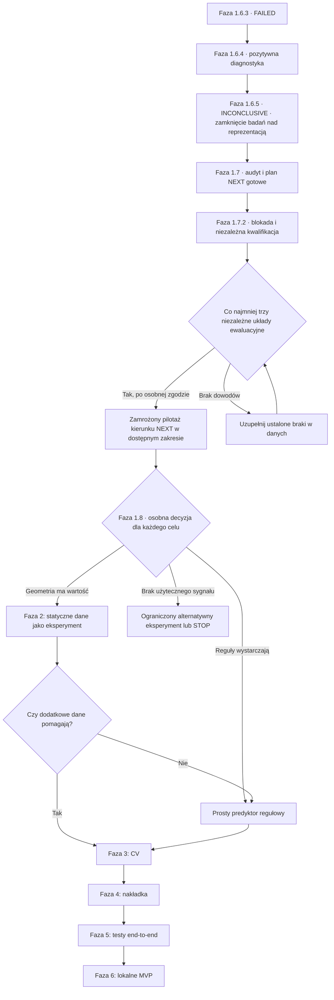
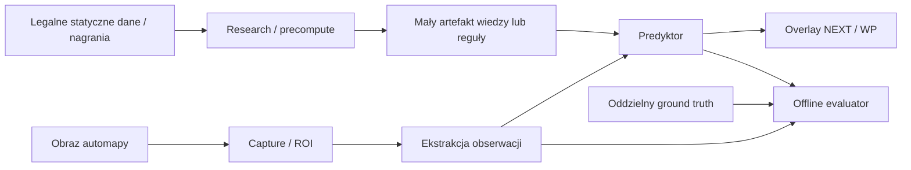

# D2R MapPredictor — Project Master Plan & Continuity Guide

**Wersja:** 1.1  
**Stan projektu:** 26 listopada 2026 r.  
**Aktualna faza:** 1.7.2 — kwalifikacja zakończona, ograniczona punktacja metody A wymaga osobnej zgody  
**Werdykt wykonalności na rzeczywistych danych D2R:** `INCONCLUSIVE` dla NEXT i WP  
**Środowisko właściciela:** Windows 10 x64, Visual Studio Code  
**Lokalny katalog projektu:** `D:/Projekty/D2MapPredicter/` (pisownia katalogu zgodna z raportami właściciela)  
**Charakter dokumentu:** nadrzędny zapis kontekstu, decyzji, roadmapy i zasad kontynuacji projektu.

> Ten dokument służy do wznowienia projektu bez dostępu do pierwotnej rozmowy. Stan bieżący i źródła pomiarów opisują raporty w repozytorium. [Status projektu](PROJECT_STATUS.md) · [Rejestr decyzji](DECISIONS.md)

## Spis treści

1. [Wizja i zakres produktu](#1-wizja-i-zakres-produktu)
2. [Mechanizm działania i ograniczenia](#2-mechanizm-działania-i-ograniczenia)
3. [Zasady techniczne i kryteria jakości](#3-zasady-techniczne-i-kryteria-jakości)
4. [Historia i aktualny stan projektu](#4-historia-i-aktualny-stan-projektu)
5. [Roadmapa całego projektu](#5-roadmapa-całego-projektu)
6. [Co zrobić teraz — faza 1.7](#6-co-zrobić-teraz--faza-17)
7. [Fazy 1.7–1.8 — benchmark i decyzja](#7-fazy-1718--benchmark-i-decyzja)
8. [Faza 2 — statyczne dane gry](#8-faza-2--statyczne-dane-gry)
9. [Faza 3 — Computer Vision](#9-faza-3--computer-vision)
10. [Faza 4 — minimalistyczna nakładka](#10-faza-4--minimalistyczna-nakładka)
11. [Fazy 5–6 — integracja i stabilizacja](#11-fazy-56--integracja-i-stabilizacja)
12. [Architektura docelowa i kontrakty](#12-architektura-docelowa-i-kontrakty)
13. [Ryzyka, alternatywy i warunki zatrzymania](#13-ryzyka-alternatywy-i-warunki-zatrzymania)
14. [Workflow agentów AI i utrzymanie kontekstu](#14-workflow-agentów-ai-i-utrzymanie-kontekstu)
15. [Prompt do wznowienia projektu](#15-prompt-do-wznowienia-projektu)
16. [Szablon aktualizacji statusu](#16-szablon-aktualizacji-statusu)

---

## 1. Wizja i zakres produktu

### Problem

W Diablo II: Resurrected gracz przemieszcza się po proceduralnie generowanych lokacjach. Szukanie przejścia do następnego poziomu i waypointu zajmuje czas, szczególnie przy wielokrotnym wykonywaniu tych samych tras.

### Produkt

D2R MapPredictor ma być **bardzo lekkim, lokalnym asystentem nawigacji**, który analizuje widoczną automapę i — w granicach faktycznie dostępnej informacji — pokazuje:

- **NEXT** — kierunek lub pozycję właściwego przejścia do kolejnej lokacji / poziomu.
- **WP** — kierunek lub pozycję waypointu.

W idealnym scenariuszu gracz wchodzi do lokacji, wykonuje teleport, a program już na podstawie układu widocznych pomieszczeń sugeruje, gdzie szukać celu. Kolejne odkryte fragmenty mogą poprawić przewidywanie. Jeżeli cel został rzeczywiście odkryty, można oznaczyć jego potwierdzoną pozycję.

**Dokładne położenie nieodkrytego celu jest aspiracją, a nie obietnicą.** Użyteczna, uczciwie oznaczona wskazówka kierunkowa jest dopuszczalnym rezultatem pośrednim. Samo rozpoznawanie już widocznych ikon nie realizuje najważniejszego celu projektu.

### Non-goals — czego projekt nie robi

- Nie wykrywa potworów, przedmiotów, run, HP, many ani mikstur.
- Nie steruje postacią, nie klika, nie wykonuje teleportów ani innych akcji za gracza.
- Nie czyta pamięci procesu gry, nie wykonuje DLL injection, nie modyfikuje plików gry i nie przechwytuje ruchu sieciowego.
- Nie obchodzi mechanizmów anti-cheat.
- Nie wymaga konta, serwera, chmury, bazy danych ani modeli AI, o ile prostsze metody wystarczają.
- Nie jest pełnym maphackiem, botem, systemem SLAM ani uniwersalnym silnikiem rozumienia gier.
- Nie próbuje na początku obsługiwać wszystkich lokacji, poziomów trudności i wariantów interfejsu.

Rozwój i testy prowadzić na nagraniach oraz w trybie offline. Brak odczytu RAM nie jest gwarancją dopuszczalności narzędzia w Battle.net ani braku ryzyka sankcji. Nie deklarować zgodności z regulaminem bez osobnej, aktualnej weryfikacji.

## 2. Mechanizm działania i ograniczenia

### Główna hipoteza badawcza

Widoczna geometria automapy może zawierać informacje o strukturze proceduralnie generowanej lokacji. Jeśli rozpoznane pomieszczenia, ich orientacje i połączenia są związane z rozmieszczeniem przejść lub waypointów, można próbować oszacować kierunek do niewidocznych celów.

Hipoteza nie została jeszcze potwierdzona na realnych danych D2R.

### Trzy poziomy możliwej realizacji

| Poziom | Metoda | Rezultat | Status |
|---|---|---|---|
| A | Reguły nawigacji zależne od obszaru i orientacji wejścia | Wskazówka kierunkowa | Baseline w fazie 1 działa według raportu; skuteczność D2R niezmierzona |
| B | Reguły + geometria odkrytych pomieszczeń + wiedza o szablonach map | Rozkład możliwych kierunków, potencjalnie pozycja | Eksperymentalny predyktor gotowy; oczekuje realnego benchmarku |
| C | Dopasowanie konfiguracji / ograniczony eksperyment odzyskiwania seeda | Potencjalna rekonstrukcja mapy i dokładna pozycja | Opcjonalna ścieżka badawcza; brak dowodu wykonalności w wymaganym czasie |

### Fundamentalne ograniczenie

Deterministyczne generowanie map nie oznacza, że można odwrócić generator na podstawie niewielkiego fragmentu jego wyniku. Dwa różne układy mogą mieć identyczną obserwowalną geometrię, ale różne położenia celów. Potwierdzono taki przypadek w syntetycznym kontrprzykładzie audytowym. Nie znamy częstości tego zjawiska w D2R.

Wyniki muszą rozróżniać:

- brak informacji (`UNKNOWN`, `INSUFFICIENT_DATA`),
- niejednoznaczność (`AMBIGUOUS`),
- predykcję kierunku (`PREDICTED`),
- predykcję położenia (tylko jeśli uzasadniona dowodami),
- rzeczywiście zaobserwowaną pozycję celu (potwierdzenie wizualne, nie predykcja).

Nie wyświetlać dokładnego punktu tylko dlatego, że jeden szablon pasuje najlepiej. Nie nazywać arbitralnego wyniku podobieństwa prawdopodobieństwem.

## 3. Zasady techniczne i kryteria jakości

### Priorytety projektowe

1. Poprawność i rzeczywista użyteczność predykcji.
2. Prostota: KISS, YAGNI, mała liczba zależności.
3. Niskie zużycie zasobów podczas rozgrywki.
4. Powtarzalność eksperymentów i rozliczalność decyzji.
5. Rozbudowa tylko na podstawie wyników, nie atrakcyjności technicznej pomysłu.

### Środowisko i stack

- Windows 10 x64, VS Code.
- C# / .NET jako preferowana technologia produkcyjna, nie bezwarunkowy wymóg.
- Python lub inna już używana technologia dopuszczalna w eksperymentach. Sprawdzić faktyczny stack w repozytorium; nie przepisywać działającego kodu tylko dla jednolitości języka.
- Faza 1 według raportu nie wymaga dodatkowych bibliotek.
- OpenCV / OpenCvSharp, Windows Graphics Capture lub Desktop Duplication, Direct2D lub prostszy mechanizm nakładki to kandydaci, a nie zatwierdzone zależności. Przed wyborem sprawdzić zgodność z konkretną wersją Windows 10 i zmierzyć koszty.

### Wstępne cele wydajnościowe runtime

| Metryka | Cel roboczy | Uwagi |
|---|---|---|
| CPU | poniżej 2% | Zdefiniować normalizację względem całego CPU, obciążenie i maszynę testową |
| RAM | poniżej 100 MB | Ustalić metrykę procesu, np. private working set, i raportować także peak |
| Aktualizacja predykcji | poniżej 100 ms | Mierzyć osobno koszt algorytmu i opóźnienie od zmiany obrazu do nakładki; p50/p95 |
| Analiza obrazu | adaptacyjnie; początkowo 10–15 Hz jako kandydat | Tylko gdy potrzebna, bez ciągłego kosztownego dopasowania |
| Sieć | brak zależności w trakcie pracy | Lokalna aplikacja |
| GPU | brak konieczności dedykowanego GPU dla AI | Sprzętowa akceleracja przechwytywania/renderowania jest dopuszczalna |

Cele nie są wynikami benchmarku ani ostatecznymi wymaganiami. Właściciel zatwierdzi progi przed testami akceptacyjnymi. Kosztowna prekomputacja może działać oddzielnie poza rozgrywką; jej czas i rozmiar wyników też trzeba mierzyć.

## 4. Historia i aktualny stan projektu

### Faza 0 — Research & Feasibility — zakończona

Opracowano koncepcję, wstępne podejścia algorytmiczne, plan badań oraz protokół eksperymentów. Rozważano template matching, graph matching, fingerprinting, reguły i seed reconstruction. Nie wykazano zgodności generatorów z D2R ani rzeczywistej trafności.

### Faza 0.5 — Independent Technical Audit — zakończona

Werdykt: `CONDITIONAL GO` (warunkowe GO).

Trzy główne założenia wymagające walidacji:

1. Geometria pierwszych trzech widocznych pomieszczeń poprawia przewidywanie względem prostej reguły orientacji wejścia.
2. Istotne cechy geometrii da się wiarygodnie odczytać z rzeczywistej automapy.
3. Skończona baza referencyjna reprezentuje mapy, które gracze faktycznie napotykają.

Audyt odtworzył przypadek syntetyczny, w którym idealnie pasujący lokalny wzorzec wskazywał błędny kierunek do obu celów. Zalecono realny pilotaż na Catacombs Level 2 zamiast natychmiastowej budowy generatora, CV i nakładki.

### Faza 1 — Experimental Implementation — zakończona implementacyjnie

Według raportu:

- Działają walidator, predyktor baseline, predyktor geometryczny i benchmark offline.
- Wszystkie **17 testów** przechodzi, w tym kontrprzykład niejednoznaczności.
- Po trzech pomieszczeniach metoda geometryczna podała kierunek w **1 z 3** kwalifikujących się przypadków dla każdego celu. W tym jednym przypadku obie metody były trafne.
- Są to dane syntetyczne. Nie dowodzą przewagi algorytmu ani trafności na rzeczywistych mapach D2R.
- Werdykt dla NEXT i WP: `INCONCLUSIVE`.

### Faza 1.5 — Data Acquisition — materiał zebrany według właściciela

Zaplanowano pilotaż około 10–15 niezależnych układów Catacombs Level 2, Normal, po wejściu z Level 1. Właściciel potwierdził, że zebrane nagrania wystarczą na aktualny etap. Dokładna liczba unikalnych, poprawnych i kwalifikujących się map nie została jeszcze przekazana.

Nie zakładać, że liczba folderów = liczba niezależnych map. Weryfikować duplikaty układów i zgodność warunków wejścia. Jeżeli materiał jest wystarczający, nie zlecać automatycznie dalszego zbierania.

### Faza 1.6 — Blind Annotation — stan przed retestem V2

Stan pilotażu `mapa-07` przed końcową oceną V1:

| Element | Stan z ostatniego raportu |
|---|---|
| Cztery izolowane paczki wczesnych klatek | Gotowe (etapy 00–03) |
| Każda paczka | Zanonimizowane `frame.png`, `README.txt`, pusty `observation.json` |
| Zawartość i odtwarzalność paczek | Sprawdzone przez agenta |
| Dopasowanie klatek | Raportowany błąd do 1,6 px na punktach kontrolnych |
| NEXT | Wstępnie potwierdzony, wymaga finalnego zatwierdzenia ground truth |
| WP | Etykieta czytelna, dokładny punkt `UNCERTAIN` |
| Niezależne adnotacje geometrii | Oczekują na wykonanie i zamrożenie |
| Testy | 17/17 według raportu |
| Realny benchmark | Jeszcze nieuruchomiony |
| Werdykt | `INCONCLUSIVE` dla obu celów |

Błąd 1,6 px jest wstępną informacją, nie samodzielnym dowodem poprawnej rejestracji całej mapy. Należy odnieść go do skali pomieszczeń, odległości celu i granic sektorów kierunkowych; w razie potrzeby sprawdzić niezależne punkty kontrolne.

### Zamknięcie badań nad reprezentacją i przygotowanie pilotażu NEXT

Retest 1.6.1 pozostaje **INCONCLUSIVE**. Bramka niezależnego testu 1.6.3 zakończyła się wynikiem **FAILED**. Faza 1.6.4 dała pozytywny wynik diagnostyczny. Ostatni test 1.6.5 zakończył się wynikiem **INCONCLUSIVE** po potwierdzeniu obustronnych zmian widoczności w ośmiu parach i braku par spełniających zamrożony próg liczby znaczników. Ścieżka badań nad reprezentacją została zamknięta. [Rejestr decyzji](DECISIONS.md#phase-16-representation-decisions) · [Ostatni test](FINAL_REPRESENTATION_RESULTS.md)

Przygotowanie 1.7 objęło dziesięć istniejących nagrań i trzy zweryfikowane kierunki NEXT w zbiorze rozwojowym. Po zgodzie właściciela w fazie 1.7.2 zamrożono źródła, klatki Stage 0, kod, reguły i identyfikatory zapytań. Niezależny ewaluator zweryfikował blokadę przed otwarciem materiału wynikowego. Etap dotyczy kwalifikacji danych. Punktacja wymaga osobnej zgody. NEXT i WP mają osobne statusy **INCONCLUSIVE**. [Audyt NEXT](NEXT_GROUND_TRUTH_AUDIT.md) · [Kwalifikacja](NEXT_EVALUATION_QUALIFICATION.md)

### Ważne istniejące pliki

Ścieżki względem `D:/Projekty/D2MapPredicter/`, podane w dotychczasowych raportach:

```text
README.md
AGENTS.md                              # przewidziany w pierwotnym planie; sprawdzić istnienie

docs/PHASE_1_RESULTS.md
docs/BLIND_ANNOTATION_GUIDE.md
docs/REGISTRATION_VALIDATION.md
docs/DATASET_QUALITY_REPORT.md
local-data/mapa-07/review/registration-check.json
local-data/phase-1-6/role-a-release/b16-k9w4-00.zip
```

Paczki etapów 01–03 istnieją według raportu; przed użyciem odczytać ich faktyczne nazwy z katalogu. Dodatkowe dokumenty Phase 0, audytu, protokołu, planu i testów mogą mieć inne nazwy niż sugerowano w poprzednich promptach. Nie odtwarzać ani nie nadpisywać ich w ciemno.

## 5. Roadmapa całego projektu

| Faza | Nazwa | Status / bramka wyjścia |
|---|---|---|
| 0 | Research | ✅ Zakończona — plan badawczy |
| 0.5 | Independent Audit | ✅ Zakończona — warunkowe GO |
| 1 | Experimental Implementation | ✅ Implementacja i testy syntetyczne; walidacja D2R otwarta |
| 1.5 | Data Acquisition | ✅ Materiał na aktualny etap zebrany; przydatność do benchmarku do potwierdzenia |
| 1.6 | Blind Annotation | ✅ Pilotaż jednego układu i ponowna ocena adnotacji |
| 1.6.1 | Retest V2 | ✅ E · INCONCLUSIVE |
| 1.6.2 | Marker Fingerprint PoC | ✅ Etap 1 zakończony. Opcja B jest rekomendacją do etapu 2 eksperymentu po zgodzie właściciela |
| 1.6.3 | Test niezależnego układu | ✅ Ocena zakończona. Bramka reprezentacji niespełniona w porównaniach po zmianie pozycji gracza |
| 1.6.4 | Diagnostyka częściowego dopasowania | ✅ Pozytywny wynik diagnostyczny |
| 1.6.5 | Ostatni test reprezentacji | ✅ INCONCLUSIVE. Ścieżka badań nad reprezentacją zamknięta |
| 1.7 | Pilotaż predykcji kierunku NEXT | 1.7.2 zakończona. Trzy niezależne układy kwalifikują się do ograniczonej próby z metodą A. Punktacja wymaga osobnej zgody |
| 1.8 | Feasibility Decision | ⏳ Wybór najprostszej uzasadnionej ścieżki |
| 2 | Static Game Data Integration | ⏳ Warunkowo — dowód kompatybilności i wartości statycznych danych |
| 3 | Computer Vision | ⏳ Automatyczna obserwacja widocznej geometrii |
| 4 | Lightweight Overlay | ⏳ Wskaźniki NEXT / WP na ekranie |
| 5 | End-to-End Validation | ⏳ Offline, jakość, wydajność i odporność na błędy |
| 6 | MVP Release & Maintenance | ⏳ Opcjonalnie — lokalne wydanie i kolejne wspierane lokacje |

Fazy 5 i 6 są doprecyzowaniem dalszego planu zaproponowanym w tym dokumencie. Fazy 2–6 nie są automatycznie zatwierdzone do wykonania. Po każdej istotnej bramce badawczej właściciel podejmuje decyzję. Możliwy jest krótszy wariant roadmapy (np. pominięcie fazy 2 przy wyborze reguł), powrót do eksperymentów albo zakończenie projektu.



## 6. Co zrobić teraz — faza 1.7

W fazie 1.7.2 zakwalifikowano `mapa-03`, `mapa-05` i `mapa-10` do niezależnej próby eksploracyjnej. Zamrożona klatka `mapa-08` pochodzi z chwili po opuszczeniu miejsca wejścia i uniemożliwia wiarygodny odczyt znacznika gracza. Pozostaje w wykazie wykluczeń. Udokumentowany rozdział ról i sposób wyboru metod uzasadniają próbę z zaślepionymi wynikami referencyjnymi. Historia wcześniejszego dostępu jest niepełna. [Kwalifikacja](NEXT_EVALUATION_QUALIFICATION.md)

Rekomendacja B przewiduje osobną decyzję właściciela o punktacji wyłącznie metody A. Zbiór rozwojowy nadal obejmuje `mapa-01`, `mapa-02` i `mapa-07`. Metoda B zwraca `UNKNOWN` przy niepotwierdzonej orientacji wejścia. Dla metody C żadna zakwalifikowana klatka Stage 0 nie zapewnia wymaganej geometrii 2D. Ograniczona próba korzysta z istniejącego materiału. Ocena przewagi geometrii oraz wykonalności NEXT i WP pozostaje otwarta. [Gotowość metod i następny krok](NEXT_EVALUATION_QUALIFICATION.md#method-readiness)

### Kontekst historyczny · diagnostyka 1.6.4 i ostatni test 1.6.5

W fazie 1.6.4 dopasowanie częściowe odtworzyło 16/16 kwalifikujących się par po maskowaniu wobec 8/16 dla metody ścisłej. W 148 porównaniach negatywnych nie pojawił się zgodny kandydat z innego regionu. Test 1.6.5 objął jeden niezależny układ i potwierdził obie zmiany widoczności. Wszystkie osiem par znalazło się poniżej progu liczby wspólnych znaczników, więc przewaga dopasowania częściowego pozostała nierozstrzygnięta. [Diagnostyka](PARTIAL_CONSTELLATION_RESULTS.md) · [Ostatni test](FINAL_REPRESENTATION_RESULTS.md)

### Kontekst historyczny · PoC 1.6.2

Etap 1 porównał trzy reprezentacje na tych samych ośmiu zamrożonych adnotacjach V2. Rekomendacja B dotyczy testu układów znaczników na małej próbce niezależnych map. Układy znaczników odtworzyły trzy wspólne punkty przy zmianie położenia gracza o ok. 448 px. Pozycje względem gracza stanowią bazę porównawczą. Ściany spełniły kryterium lokalnej zgodności, ale nie zmieniły dopasowań. Następny etap wymaga osobnej zgody właściciela. [Wyniki PoC](MARKER_FINGERPRINT_POC_RESULTS.md)

Benchmark NEXT i WP nadal wymaga rozłącznych zbiorów i zweryfikowanych etykiet każdego celu. Przetwarzanie pozostałych nagrań i faza 2 projektu podlegają odrębnym bramkom. [Projekt małego testu](REPRESENTATION_DECISION.md#2-small-independent-layout-screen-only-if-the-first-stage-passes)

### Kontekst historyczny · retest 1.6.1

Faza 1.6.1 zakończyła ocenę ośmiu adnotacji V2. Oba przypisania SEMANTIC jako pierwszego przebiegu zostały złamane i żadna para nie spełnia warunku formalnego porównania kolejności. W obliczeniach eksploracyjnych znaczniki były powtarzalne w obu formatach. Brakuje środka pomieszczenia wejściowego, potwierdzonych połączeń i ślepych pomieszczeń, a na etapie 3 dopasowano dwa z ośmiu odcinków RAW przy wymaganym minimum czterech. Wynik bramki to E · INCONCLUSIVE. [Wyniki retestu](ANNOTATION_RETEST_RESULTS.md)

### Archiwalna procedura pilotażu V1

Pierwszym krokiem było przekazanie wyłącznie paczki `b16-k9w4-00.zip` niezależnemu anotatorowi, w świeżej sesji AI bez historii, pamięci projektu, dostępu do repozytorium ani późniejszych klatek. Alternatywą była osoba, która nie widziała nagrania. Cała poniższa procedura opisuje ten pierwotny pilotaż.

#### Podział ról

| Rola | Dozwolone informacje | Zadanie |
|---|---|---|
| A — Blind Geometry Annotator | Tylko aktualnie udostępniona wczesna klatka i jej instrukcja | Opisać obserwowalną geometrię |
| B — Ground Truth Annotator | Pełne nagrania, mapy końcowe, rejestracja | Potwierdzić tożsamość, pozycje i widoczność celów |
| C — Independent Evaluator | Zamrożone adnotacje i oddzielny ground truth | Sprawdzić dane i wykonać benchmark |

Fizyczna izolacja danych jest ważniejsza od samej deklaracji agenta. Rola A nie może korzystać z historii innych sesji, internetowych map, przewidywanych pozycji, końcowej automapy ani plików rejestracji ujawniających cele.

#### Sekwencja wykonania

1. Odczytać istniejący `BLIND_ANNOTATION_GUIDE.md` i zachować jego schemat.
2. Przekazać paczkę etapu 00 roli A. Otrzymać wypełniony `observation.json` z opisem niepewności.
3. Zachować oryginalną odpowiedź, sprawdzić składnię i zamrozić wynik przed udostępnieniem kolejnej paczki. Nie dopisywać danych o celu.
4. Powtórzyć dla 01, 02, 03. Nie poprawiać wcześniejszych obserwacji na podstawie późniejszych. Jeżeli instrukcja przewiduje obserwacje skumulowane, korzystać wyłącznie z już zamrożonych, wcześniejszych obserwacji — nigdy z przyszłych.
5. Rola B kończy weryfikację NEXT i WP na podstawie materiału źródłowego, niezależnie od adnotacji A.
6. Jeżeli dokładna lokalizacja WP pozostaje `UNCERTAIN`, nie wymuszać współrzędnych. Wykluczyć niekwalifikujące się obserwacje WP zgodnie z protokołem, zachować poprawne dane NEXT.
7. Rola C weryfikuje rejestrację, poprawność JSON, kolejność obserwacji, widoczność celów i brak wycieku danych. Nie modyfikuje geometrii, by dopasować ją do ground truth.
8. Przeprowadzić pilotaż całego przepływu na `mapa-07`. Jeśli pilot wpływa na schemat, reguły lub dobór cech, traktować go jako dane rozwojowe, nie niezależny test.
9. Po pozytywnej weryfikacji procedury przetworzyć pozostałe niezależne mapy.

#### Krótki prompt wyłącznie dla anotatora A

```text
You are an independent visual geometry annotator. The attached ZIP contains
frame.png, README.txt and observation.json.

Read the instructions, inspect only the supplied image, and fill observation.json
without changing its schema. Record only directly observable information.
Distinguish confirmed geometry from unknown or ambiguous geometry. Never infer
undiscovered rooms or classify an unexplored passage as a confirmed dead end.
Do not access other files, future frames, previous project conversations, external
maps, game guides or web research. Do not guess target positions.

Return valid completed JSON and a short note identifying ambiguous or unreadable
fields. Accuracy is more important than completeness. Stop after this observation.
```

#### Pierwotne kryteria pilotażu V1

- [ ] Cztery niezależne adnotacje `mapa-07` zapisane i zamrożone.
- [ ] Rejestracja sprawdzona, a niepewność współrzędnych udokumentowana.
- [ ] NEXT i WP mają osobne statusy ground truth (`VERIFIED`, `UNCERTAIN`, `MISSING`, `INVALID`).
- [ ] Walidator przyjmuje kwalifikujące się dane; brakujące pola nie są wymyślane.
- [ ] Pilot potwierdza działanie procesu od obrazów do danych wejściowych benchmarku.
- [ ] Pozostałe nagrania opisane według tej samej procedury.
- [ ] Niezależne układy map rozdzielone na development i evaluation; podział oraz kryteria zamrożone przed właściwą oceną.
- [ ] Testy pozostają zielone; ewentualne zmiany techniczne i ich powody odnotowane.

**Nie implementować w tej fazie nowych algorytmów, generatora, automatycznego CV ani nakładki.**

## 7. Fazy 1.7–1.8 — benchmark i decyzja

### 1.7 — Pilotaż kierunku do ukrytego NEXT

Pytanie dotyczy korzyści z informacji widocznej bezpośrednio po wejściu na Catacombs Level 2 z poziomu 1 na Normal. Punkt kontrolny to zamrożona klatka Stage 0. Wynik to jeden z czterech sektorów wektora od gracza do ukrytych schodów na poziom 3. Pozycja celu, rozpoznanie mapy i przejezdność trasy są osobnymi pytaniami. [Plan pilotażu](NEXT_PREDICTION_PILOT_PLAN.md)

- Minimum eksploracyjne obejmuje trzy zweryfikowane układy rozwojowe i trzy niezależne układy ewaluacyjne. Etykiety i późniejsze kadry zbioru ewaluacyjnego pozostają po stronie ewaluatora. Dobór metod, reguły kwalifikacji i kod muszą zostać zamrożone przed osobno zatwierdzonym otwarciem etykiet. [Podział i dostęp](NEXT_PREDICTION_PILOT_PLAN.md#split-and-evaluation-independence)
- Porównać prostą częstość sektorów i częstość warunkowaną obserwowalną orientacją wejścia. Konsensus geometryczny jest warunkowy i korzysta z istniejącego zamrożonego dopasowania. Brak informacji skutkuje `UNKNOWN`. [Metody](NEXT_PREDICTION_PILOT_PLAN.md#prospective-methods)
- W przyszłym raporcie użyć jednej obserwacji na układ. Podać trafne, błędne i wstrzymane odpowiedzi, pokrycie, trafność wśród odpowiedzi, trafienia na kwalifikujący się układ, błąd kątowy oraz porównanie przy tym samym pokryciu. Próba służy do wykrycia sygnału. Szerszy benchmark i ocena gotowości produktu zachowują własne kryteria. [Kryteria pilotażu](NEXT_PREDICTION_PILOT_PLAN.md#metrics-and-proposed-decision-criteria) · [Pełny benchmark](../benchmarks/PROTOCOL.md)

### 1.8 — Feasibility Decision

Werdykt wydawać **osobno dla NEXT i WP**. Projekt może wspierać tylko jeden cel na początku, ale wymaga to jawnej zgody właściciela na ograniczenie MVP.

| Werdykt | Znaczenie | Kolejne działanie |
|---|---|---|
| GO | Realne dane wskazują użyteczną przewagę geometrii | Zbadać, czy statyczne dane poprawią wynik lub uproszczą rozwiązanie |
| CONDITIONAL GO | Obiecujący sygnał, lecz zbyt mała próba lub konkretny brak | Zaplanować jeden eksperyment, który usuwa tę niewiadomą |
| PIVOT | Proste reguły dają porównywalną wartość | Wybrać reguły, uprościć produkt; faza 2 może być zbędna |
| NO-GO | Testowana metoda nie daje użytecznej predykcji | Zatrzymać tę metodę; nie budować na niej CV ani overlayu |
| INCONCLUSIVE | Brak rozstrzygających danych lub zbyt słaba ich jakość | Uzupełnić konkretne braki, nie rozbudowywać aplikacji w ciemno |

`NO-GO` dla testowanego predyktora geometrycznego nie dowodzi automatycznie, że każda metoda wykorzystująca statyczne dane jest niemożliwa. Alternatywną ścieżkę należy jednak uzasadnić nową, testowalną hipotezą. Decyzja o finansowaniu dalszego czasu pracy należy do właściciela.

**Bramka:** zapisać `PHASE_1_FINAL_VERDICT.md` lub aktualny odpowiednik; wskazać dokładnie, co udowodniono, czego nie, czy warto kontynuować i którą ścieżką. Nie uruchamiać fazy 2 automatycznie.

## 8. Faza 2 — statyczne dane gry

Faza warunkowa. Nie jest obowiązkowa, jeśli nawigacja regułowa osiąga oczekiwaną wartość. Nie importować dużych repozytoriów i nie generować milionów map przed ustaleniem sensu tych operacji.

### 2A — Compatibility Spike

**Cel:** ustalić, czy dostępne statyczne dane i generator opisują rzeczywiste mapy D2R w sposób wystarczający do naszego zadania.

Kandydaci do ponownego sprawdzenia (linki z wcześniejszego researchu, nie gwarancja aktualnego stanu lub kompatybilności):

- [emmericp/diablo2-maps](https://github.com/emmericp/diablo2-maps) — eksperymenty z mapami i seedem.
- [jaenster/libd2](https://github.com/jaenster/libd2) — potencjalne parsery i generowanie map.
- [jcageman/d2mapapi](https://github.com/jcageman/d2mapapi) — potencjalne generowanie map przy znanym seedzie.
- [OpenDiablo2/OpenDiablo2](https://github.com/OpenDiablo2/OpenDiablo2) — interpretacja danych gry.
- [lucas-gp/MapAssist](https://github.com/lucas-gp/MapAssist) — tylko odniesienie do statycznego generowania i reprezentacji map; nie używać mechanizmów pamięci procesu.

Dla wybranego komponentu zweryfikować kod, licencję, wymagane zasoby, obsługiwane wersje, działanie offline, sposób instalacji, możliwość ponownego użycia i wyniki na niezależnych danych D2R. Nie zakładać zgodności klasycznego D2 1.13c/1.14d z aktualnym D2R.

Pliki do sprawdzenia: DS1, DT1, Levels.txt, LvlPrest.txt, LvlMaze.txt, LvlTypes.txt, LvlWarp.txt, Automap.txt. Ustalić ich rzeczywistą dostępność i funkcję na podstawie kodu/parsera oraz danych; używać wyłącznie legalnie dostępnych lokalnych zasobów, nie modyfikować gry i nie dołączać zastrzeżonych plików gry do repozytorium ani wydania.

**Bramka 2A:** co najmniej jeden powtarzalny eksperyment porównujący statyczny szablon lub wynik generatora z rzeczywistą geometrią automapy, z jednoznaczną metodą dopasowania i opisem ograniczeń. Jeśli nie da się wiarygodnie wykazać zgodności generatora całych map, nie używać jego wyników jako ground truth D2R; można osobno badać zgodność pojedynczych szablonów.

### 2B — Minimal Tile/Room Library

- Dla jednej lokacji wybrać minimalny zbiór istotnych szablonów i reguł.
- Zdefiniować konwersję ze statycznej geometrii do reprezentacji automapy. Nie utożsamiać współrzędnych ekranu, świata, kolizji, pokoju i kafelka.
- Przygotować kompaktowe opisy połączeń, orientacji i istotnych cech. Nie przechowywać pełnych tekstur, jeśli wystarcza geometria.
- Sprawdzić kolizje sygnatur: różne pokoje lub konfiguracje mające ten sam opis.
- Potwierdzić na rzeczywistych klatkach, że wybrane cechy rzeczywiście da się rozpoznać.

### 2C — Matching & Prediction Experiment

Porównywać kolejno: baseline regułowy → dotychczasowy predyktor geometryczny → predyktor wzbogacony o statyczne dane. Dodawać jeden mechanizm naraz. Testować na osobnym zbiorze układów, których nie użyto do strojenia.

Preferowana kolejność eksperymentów:

1. Rozpoznawanie małych szablonów i reguł orientacji.
2. Proste lokalne sygnatury (np. połączenia, graf sąsiedztwa, hash geometryczny).
3. Kompaktowe indeksy lokalnych wzorców i rozkłady możliwych położeń, jeśli poprzedni krok daje sygnał.
4. Dopasowanie większych konfiguracji dopiero po potwierdzeniu, że lokalne wzorce są niewystarczające.

Przed dużą prekomputacją zmierzyć liczbę unikalnych wzorców, duplikaty, rozmiar indeksu, czas wyszukania, niejednoznaczność i trafność na mapach spoza bazy. Nie mylić odnalezienia znanej mapy w indeksie z generalizacją na nieznany układ.

**Bramka 2C:** statyczne dane poprawiają trafność, pokrycie lub istotnie upraszczają runtime względem już zweryfikowanej metody. Jeśli nie — wrócić do lżejszego predyktora.

### 2D — Seed Reconstruction (opcjonalny, osobno zatwierdzany research)

Tylko jeśli właściciel nadal potrzebuje dokładnych pozycji nieodkrytych celów, a istnieją przesłanki, że obserwacje pozwalają ograniczyć przestrzeń kandydatów. Pracować na legalnych statycznych danych, mapach referencyjnych, własnych nagraniach i eksperymentach offline.

Najpierw oszacować, ile informacji wnoszą obserwacje, czy różne seedy dają te same cechy i czy rozbieżne konfiguracje mają różne cele. Zdefiniować budżet czasu, RAM i prekomputacji oraz jednoznaczne kryterium zatrzymania eksperymentu. Nie wdrażać nieograniczonego przeszukiwania przestrzeni ani nie uzależniać całego MVP od tej metody.

Rezultat może być negatywny: sam obraz nie musi pozwalać na jednoznaczne i szybkie odzyskanie seeda. Zachować możliwość rezygnacji lub predykcji kierunkowej bez rekonstrukcji.

## 9. Faza 3 — Computer Vision

**Warunek startu:** mamy wybraną użyteczną metodę predykcji, przetestowaną dotychczas z ręcznie opisanymi obserwacjami. Jeśli wybrano prosty baseline, ograniczyć CV do cech, których baseline potrzebuje. Nie budować uniwersalnego systemu analizy obrazu.

### 3A — Offline image processing

Na zapisanych klatkach, bez uruchamiania gry:

- Zdefiniować wspieraną konfigurację MVP: rozdzielczość, skalę UI, tryb automapy, grafikę klasyczną lub remastered. Wybrać jeden wariant na start.
- Zidentyfikować ROI automapy, odseparować jej geometrię od tła i efektów graficznych.
- Rozpoznać tylko potrzebne cechy: orientację wejścia, pozycję gracza, kontury/połączenia pomieszczeń, ewentualnie widoczne symbole NEXT/WP.
- Preferować proste maski kolorów, progi, kontury, linie i template matching zamiast AI. OCR nie jest wymagany, chyba że prostsze metody identyfikacji obszaru zawiodą i zostanie to uzasadnione.
- Odróżnić niewidoczne, nieodkryte, nieczytelne i potwierdzone elementy.
- Wyeksportować automatyczne obserwacje do tego samego lub kompatybilnego kontraktu, którego używa benchmark.

Zmierz zgodność automatycznych cech z niezależnymi adnotacjami, ale przede wszystkim ponownie zmierz końcową trafność predykcji. Dobra segmentacja sama w sobie nie jest dowodem dobrej nawigacji. Jeżeli automatyzacja obniża trafność zbyt mocno, poprawić wyłącznie problematyczne cechy lub uprościć model.

### 3B — Live screen capture

Po walidacji offline:

- Wybrać minimalny mechanizm przechwytywania dla Windows 10 i aktualnej konfiguracji maszyny.
- Przechwytywać wymagany obszar, nie cały pulpit, jeśli technicznie możliwe.
- Wykrywać zmianę istotnej geometrii i przeliczać predykcję tylko wtedy, gdy jest to potrzebne. Ruch tła lub animacji nie powinien sam powodować kosztownego dopasowania.
- Przechowywać najwyżej niezbędny bufor ostatnich klatek; unikać kolejek zaległych obserwacji.
- Rozpoznać brak automapy, utratę fokusu, zmianę rozdzielczości, ekran ładowania i zmianę lokacji. Jeśli automatyczne rozpoznanie lokacji okaże się kosztowne, dopuścić na początku ręczny wybór jedynej wspieranej lokacji.
- Nie wykorzystywać dostępu do procesu gry w celu pozyskania danych rozgrywki.
- Nie zapisywać zrzutów ekranu domyślnie. Tryb diagnostyczny wyłącznie na życzenie.

### 3C — Obsługa teleportacji i cyklu mapy

Rozróżnić zmianę widoku w ramach tej samej mapy od rozpoczęcia nowego układu. W pierwszym przypadku wykorzystać wcześniejsze wiarygodne obserwacje tylko wtedy, gdy da się je poprawnie zarejestrować. W drugim wyczyścić stan. Gdy stan lub współrzędne są niepewne, zrezygnować z predykcji zamiast rysować stary kierunek.

**Bramka fazy 3:** automatyczne obserwacje dają użyteczne wyniki na niezależnych nagraniach, przechwytywanie działa w trybie offline i mieści się w uzgodnionym budżecie zasobów. Zweryfikować też wejście z WP/portalu i po teleportacji; nie deklarować ich obsługi na podstawie wyników tylko dla wejścia z L1.

## 10. Faza 4 — minimalistyczna nakładka

**Cel:** dostarczyć wartość bez zbędnego GUI. Nakładka nie może ukrywać obszaru walki ani przejmować sterowania.

### Zakres MVP

- Przezroczysta nakładka nad oknem gry, nieprzechwytująca kliknięć.
- Dwa czytelne znaczniki: `NEXT` i `WP`.
- Dla potwierdzonej pozycji — znacznik celu, jeśli mieści się w poprawnie zarejestrowanym widoku.
- Dla nieodkrytego celu — strzałka kierunkowa lub jawnie oznaczona przybliżona strefa, jeśli metoda jest zweryfikowana.
- Dla stanu `UNKNOWN` / `INSUFFICIENT_DATA` — brak strzałki; nie wymuszać odpowiedzi.
- W razie niejednoznaczności — najwyżej prosty sygnał niepewności, bez zalewania ekranu wieloma wariantami.
- Jeden skrót włączenia/wyłączenia nakładki i prosty sposób zamknięcia programu.
- Nakładka ukrywa się, gdy gra nie jest aktywna, automapa nie jest czytelna lub stan jest nieaktualny.

Nie dodawać PREV, dashboardu, śledzenia łupów, rozbudowanego menu ustawień ani planowania pełnej trasy, dopóki właściciel nie rozszerzy zakresu. Strzałka kierunkowa nie oznacza bezpiecznej, przejezdnej ścieżki; nie nazywać jej pathfindingiem.

### Wykonanie

Najpierw renderować znaczniki z zapisanych stanów predykcji, niezależnie od gry. Następnie podłączyć przepływ danych live. Wybrać prostą technologię renderowania zgodną z Windows 10. Zmierzyć wpływ DPI, zmiany rozmiaru okna, trybu borderless/windowed, przełączania okien oraz przejść między lokacjami. Nie obiecywać obsługi exclusive fullscreen, zanim nie zostanie przetestowana.

**Bramka fazy 4:** użytkownik widzi poprawnie rozróżnione wskazówki NEXT/WP w obsługiwanych scenariuszach offline, nakładka nie przeszkadza w rozgrywce, a jej koszt jest zmierzony. Nie wyświetla starych ani nieuzasadnionych predykcji.

## 11. Fazy 5–6 — integracja i stabilizacja

### Faza 5 — End-to-End Validation & Performance

Wykonać testy kompletnego przepływu: obraz → obserwacja → predykcja → nakładka. Oddzielnie mierzyć jakość samego predyktora, błędy CV, rejestrację i renderowanie, aby wiedzieć, gdzie powstaje problem.

Minimalne scenariusze:

- Pierwsze wejście do lokacji i kolejne odkrywanie pomieszczeń.
- Wejście przez WP lub portal, jeśli ma być wspierane.
- Krótkie i długie teleporty, utrata możliwości rejestracji, powrót do odkrytego miejsca.
- Wcześniejsze odkrycie NEXT niż WP i odwrotnie; cel poza kadrem.
- Zamknięta automapa, menu, ładowanie, Alt+Tab, utrata fokusu.
- Nowa mapa, zmiana lokacji, trudności, konfiguracji obrazu i DPI.
- Błędne, niepełne i niejednoznaczne obserwacje.
- Powtarzane sesje i dłuższy test pod kątem wycieków pamięci oraz narastania opóźnień.

Wskaźniki: końcowa trafność/pokrycie dla każdego celu, p50/p95 czasu reakcji, średnie i szczytowe CPU/RAM, wpływ na FPS gry i ewentualne zużycie GPU. Mierzyć na rzeczywistym komputerze właściciela; ustalić konfigurację, metodologię i punkt odniesienia (gra bez programu). Sprawdzić, czy zła wskazówka zwiększa czas szukania celu. Jeśli to możliwe, ocenić użyteczność w krótkiej próbie nawigacji z programem i bez niego na porównywalnych niezależnych mapach, offline.

**Bramka:** brak krytycznych błędów i wycieków danych, zaakceptowana jakość wskazówek, rzeczywiste pomiary zasobów, kontrolowane zachowanie w razie braku danych. W razie potrzeby zmniejszyć zakres, a nie ukrywać ograniczeń.

### Faza 6 — Local MVP Release & Maintenance

- Wydać prosty lokalny artefakt wykonywalny (format dystrybucji zależy od faktycznego stacku).
- Opisać uruchomienie, wspierane wersje Windows i gry, ustawienia automapy, wspierane lokacje oraz znane ograniczenia.
- Dołączyć tylko własne lub licencjonowane do redystrybucji komponenty. Nie pakować zasobów gry bez odpowiednich praw.
- Nie deklarować niewykrywalności, bezpieczeństwa konta ani dopuszczalności w rozgrywce online. Użytkowanie i walidacja projektu pozostają offline.
- Dodać wersjonowanie danych referencyjnych, krótki changelog oraz procedurę weryfikacji po aktualizacjach gry.
- Zabezpieczyć zachowanie przy niewspieranej wersji: ukryć lub ograniczyć wskazówki zamiast zwracać przypadkowe wyniki.
- Rozszerzać obsługę lokacji pojedynczo dopiero po zaakceptowaniu MVP. Forgotten Tower i Durance of Hate Level 2 pozostają kandydatami z pierwotnego planu, nie obietnicą obsługi.

MVP nie oznacza, że wszystkie pierwotne aspiracje zostały osiągnięte. Jasno opisać, czy produkt oferuje tylko kierunek, przewidywaną pozycję czy potwierdzoną pozycję odkrytego celu oraz dla których sytuacji.

## 12. Architektura docelowa i kontrakty

Architektura jest propozycją docelową, nie poleceniem tworzenia wszystkich modułów już teraz. Zachować aktualną strukturę repozytorium, jeśli działa.



### Research Engine (offline)

- Import i adnotacja danych.
- Walidacja i benchmarki.
- Eksperymenty z generatorami, regułami i szablonami.
- Prekomputacja, jeżeli jej wartość zostanie dowiedziona.
- Eksport minimalnego, wersjonowanego artefaktu potrzebnego runtime.

### Runtime Engine (finalny produkt)

- Przechwycenie ROI automapy.
- Ekstrakcja minimum obserwacji.
- Aktualizacja stanu mapy oraz wybrana metoda predykcji.
- Odczyt gotowych reguł / indeksu, jeśli wymagany.
- Nakładka NEXT/WP i minimalna obsługa cyklu życia.

Ground truth i pełne dane benchmarku nie są zależnością runtime ani wejściem predyktora. Nie przenosić całej infrastruktury badawczej do aplikacji użytkowej.

### Kontrakt obserwacji

Właściwy schemat istnieje w repozytorium. Poniższy przykład ilustruje pojęcia, a nie zastępuje go:

```json
{
  "area": "Catacombs2",
  "difficulty": "Normal",
  "entrance_orientation": "NE",
  "player_position": [0, 0],
  "visible_rooms": [],
  "visible_connections": []
}
```

Dokumentować układ współrzędnych, źródło cech, etapy obserwacji i niepewność. Identyfikatory map są metadanymi ewaluatora; nie mogą pozwolić predyktorowi rozpoznać odpowiedzi poprzez przypadkową korelację z etykietami.

### Kontrakt predykcji

Ilustracja możliwego stanu, do uzgodnienia z istniejącym kodem:

```json
{
  "target": "NEXT",
  "status": "PREDICTED",
  "direction": "NE",
  "confidence": null
}
```

Jeżeli runtime rozszerzy kontrakt, dodać jedynie potrzebne pola: rodzaj wyniku (kierunek/pozycja), potwierdzenie wizualne, układ współrzędnych, identyfikator bieżącego stanu mapy i informację o aktualności. Nie wprowadzać arbitralnej pewności procentowej. Wynik dla WP i NEXT jest niezależny. Wyświetlenie znacznika wymaga aktualnej obserwacji i poprawnej transformacji do ekranu.

### Orientacyjna struktura katalogów

```text
D2MapPredicter/
  README.md
  AGENTS.md
  docs/
    PROJECT_MASTER_PLAN.md
    ... istniejące raporty i protokoły ...
  research/                 # eksperymenty, jeśli potrzebne
  src/                      # faktyczny kod projektu
  tests/
  fixtures/                 # małe, kontrolowane dane testowe
  local-data/               # prywatne nagrania, paczki i adnotacje
  benchmarks/               # istniejące narzędzia / wyniki
```

Nie tworzyć pustych katalogów dla przyszłych faz. Sprawdzić `.gitignore`: lokalne nagrania, pełne mapy, prywatne dane, artefakty dużych obliczeń i oryginalne zasoby gry nie powinny przypadkowo trafić do publicznego repozytorium. Jeśli materiały są poza Gitem, przechowywać je w oddzielnej kopii zapasowej wraz z manifestem wersji.

## 13. Ryzyka, alternatywy i warunki zatrzymania

| ID | Ryzyko | Sposób sprawdzenia / ograniczenia |
|---|---|---|
| R1 | Widoczna geometria nie daje informacji o położeniu celu | Realny benchmark, przypadki identycznych obserwacji z różnym wynikiem, abstencja |
| R2 | Predyktor nie przewyższa prostego baseline | Porównanie przy takim samym pokryciu i na niezależnych mapach |
| R3 | Dane klasycznego D2 nie odpowiadają D2R | Compatibility spike na rzeczywistych danych; nie uznawać generatora za ground truth bez walidacji |
| R4 | Wzorce z indeksu nie generalizują | Ewaluacja poza bazą, test duplikatów, rozmiar i złożoność indeksu |
| R5 | Wyciek ground truth lub przyszłych obserwacji | Fizyczna izolacja danych, zamrożenie, osobne role, kontrola podziału per mapa |
| R6 | Błędna rejestracja klatek lub punktu WP/NEXT | Niezależne punkty kontrolne, statusy niepewności, analiza granic sektorów |
| R7 | CV nie odczytuje cech niezawodnie | Testy automatycznych cech na rzeczywistych kadrach i porównanie końcowej predykcji |
| R8 | Wydajność nie odpowiada idei lightweight | Pomiar p50/p95, CPU, RAM, FPS; uproszczenie, prekomputacja, aktualizacja przy zmianie |
| R9 | Teleport, zmiana obszaru lub nowa gra daje nieaktualną wskazówkę | Reset/inwalidacja stanu, testy cyklu życia, abstencja |
| R10 | Nadmierna rozbudowa przez agentów AI | Jeden mierzalny eksperyment na etap, kontrola zakresu i osobne approval gates |
| R11 | Aktualizacja gry lub systemu zmienia zachowanie | Wersjonowanie, lista wspieranych konfiguracji, testy po zmianach |
| R12 | Ograniczenia licencyjne lub regulaminowe | Weryfikacja źródeł/licencji, użycie offline, brak obietnic zgodności online |

### Alternatywne ścieżki produktu

**A. Rule-based Navigator:** najprostszy wariant, jeśli reguły są dostatecznie przydatne; identyfikacja orientacji i obszaru, dwa kierunkowskazy. Bez pełnej bazy map.

**B. Geometry-assisted Navigator:** reguły wspierane rozpoznaną geometrią, niewielkim zbiorem wzorców lub rozkładami kierunków. Preferowana ścieżka badawcza, jeśli benchmark daje przewagę.

**C. Static-data / seed-assisted Predictor:** ścieżka warunkowa, jeśli dodatkowe badania rzeczywiście uzasadnią dokładniejsze pozycje i koszt obliczeń. Nie traktować jako koniecznego elementu produktu.

**D. STOP / ograniczenie produktu:** jeśli nie można uzyskać użytecznych wskazówek do nieodkrytych celów, nie udawać, że samo zaznaczanie odkrytych ikon realizuje pierwotny cel. Taki prostszy produkt wymaga osobnej decyzji właściciela.

### Kiedy zatrzymać prace

- Brak realnych danych lub ground truth — blokada ewaluacji, nie pretekst do rozbudowy kodu.
- Brak przewagi nad baseline — pivot albo zakończenie testowanej metody.
- Brak wiarygodnej zgodności danych gry — zakończyć integrację niewiarygodnego źródła.
- Przekroczenie budżetu kosztownej prekomputacji lub brak realnej wartości — odrzucić dany wariant.
- Błędne wskazówki o nieakceptowalnej częstości — ograniczyć coverage, uprościć albo wstrzymać wydanie.

Nie istnieje obowiązek dojścia do ostatniej fazy. Projekt ma służyć właścicielowi, a nie realizacji roadmapy za wszelką cenę.

## 14. Workflow agentów AI i utrzymanie kontekstu

Wcześniej przyjęto model podobny do podziału Shaper / Orchestrator, rozszerzony o niezależnych audytorów i walidatorów.

| Rola | Odpowiedzialność |
|---|---|
| Owner / Shaper | Właściciel; cel, zakres, priorytety, zgoda na przejście faz, decyzja o kompromisach |
| Researcher | Weryfikuje hipotezy i źródła; tworzy mierzalny eksperyment |
| Orchestrator / Implementer | Wykonuje uzgodniony plan, małe zmiany, testy, reprodukcja |
| Independent Auditor | Szuka błędów w założeniach, metodologii, kodzie i dowodach; nie broni wcześniejszych decyzji |
| Blind Annotator (A) | W fazie 1.6 widzi wyłącznie dozwoloną klatkę i formularz |
| Ground Truth Annotator (B) | Weryfikuje rzeczywiste położenie i widoczność celów |
| Validator / Evaluator (C) | Weryfikuje zamrożone dane i wyniki, bez strojenia pod zbiór testowy |

Nie wszystkie role wymagają osobnych osób przez cały projekt. Rozdzielenie sesji jest szczególnie istotne przy niezależnym audycie i ślepej adnotacji. Nie przekazywać tego dokumentu ślepemu anotatorowi.

### Stały cykl dla każdej kolejnej fazy

1. Odczytaj bieżący stan repozytorium, raporty i ostatnie decyzje.
2. Wybierz jedną niewiadomą / jedno zadanie, które odblokowuje następną fazę.
3. Zdefiniuj scope, non-goals i warunek zakończenia.
4. Wykonaj najmniejszy testowalny fragment pracy.
5. Uruchom testy, zapisz komendy i rzeczywiste rezultaty.
6. Niezależnie sprawdź krytyczne wnioski.
7. Zaktualizuj status, decyzje, ryzyka i następny krok.
8. Przed zmianą fazy, kosztowną operacją lub zmianą zakresu uzyskaj zgodę właściciela.

Nie tworzyć kolejnych wielkich dokumentów tylko dlatego, że zmienia się faza. Preferować aktualizację istniejących plików. W raportach rozdzielać fakty zweryfikowane, raportowane, założenia, hipotezy i blokady. Nie uznawać zielonych testów syntetycznych za realną trafność w D2R.

### Dokumentacja zachowująca kontekst

Zalecane minimum:

- `docs/PROJECT_MASTER_PLAN.md` — ten dokument, wizja, historia i plan, aktualizowany przy ważnych decyzjach.
- `docs/PROJECT_STATUS.md` — krótkie aktualne podsumowanie: co zrobione, ostatni test, blokada, jeden następny krok.
- Istniejący rejestr decyzji (np. `docs/DECISIONS.md`) — ważne rozstrzygnięcia i uzasadnienie.
- Istniejące raporty eksperymentów — dowody i komendy reprodukcji, nie zastępować ich streszczeniem.
- `AGENTS.md` — krótka instrukcja dla agentów: przeczytać master plan i status przed pracą oraz aktualizować status po zakończeniu zadania. Nie kopiować całej roadmapy do AGENTS.md.

Jeżeli repozytorium ma już równoważne pliki, użyć ich zamiast tworzyć duplikaty. W przypadku rozbieżności aktualny kod, zamrożone protokoły, wiarygodne wyniki i najnowsze decyzje właściciela są ważniejsze niż historyczny opis roadmapy.

**Ważne:** sam plik MD nie przechowuje kodu, nagrań, ground truth ani wyników benchmarków. Zachować repozytorium (np. Git + kopia), osobny backup `local-data/` i materiałów nieobjętych Gitem. W nowej sesji AI otworzyć repozytorium z tym dokumentem i aktualnym statusem. Jeśli nie ma dostępu do danych, nie pozwalać agentowi udawać, że je sprawdził.

## 15. Prompt do wznowienia projektu

Poniższy prompt jest dla nowej sesji agenta implementacyjnego/audytorskiego w VS Code, nie dla ślepego anotatora. Nie wymaga dostępu do poprzedniej rozmowy.

```text
# D2R MapPredictor — Project Continuation

Act as a pragmatic research engineer and software orchestrator.

This is an existing project, not a greenfield implementation.
Read docs/D2R_MapPredictor_PROJECT_MASTER_PLAN.md first. Then inspect AGENTS.md, README.md,
the latest project status, actual source code, tests, experiment protocols,
audit findings and relevant reports. Locate equivalent files if names differ.
Treat repository evidence and the owner's latest decisions as authoritative.

Project objective: an extremely lightweight local navigation assistant for
Diablo II: Resurrected that predicts or indicates NEXT and WP using only
visible game imagery and legally accessible static data. No game process
memory reading, injection, game file modification, network interception,
anti-cheat bypass or gameplay automation. Development and validation are offline.

Preserve the validated scope, existing tools and experimental methodology.
Do not restart Phase 0, rewrite working modules or implement future phases
just because the master plan mentions them. Avoid overengineering.

First report:
1. Current phase and last completed verified task.
2. Actual test/benchmark status, citing repository evidence.
3. Open blockers and uncertainty, separately for NEXT and WP.
4. Any differences between the master plan and current repository state.
5. The smallest next actionable step, its acceptance criteria, and non-goals.
6. Which phase gate or hypothesis this step addresses.

Read docs/PROJECT_STATUS.md, docs/NEXT_GROUND_TRUTH_AUDIT.md and
docs/NEXT_PREDICTION_PILOT_PLAN.md. The representation-only track is closed.
Read docs/NEXT_EVALUATION_QUALIFICATION.md for the Phase 1.7.2 execution lock,
qualified layout count, access limitations and method readiness. Three
development layouts have verified arrival bearings. Preserve the fixed Stage 0
and four-sector rules. Keep reserved target evidence evaluator-side. Require
separate owner approval for prediction scoring. Keep WP separate.

Proceed only within the current approved task. Before advancing to a new
phase or changing scope, present the evidence, decision and next step to
the project owner for approval.

When finishing any task, update the existing project status document:
- completed work and changed files;
- reproducible test/benchmark commands and actual results;
- remaining blockers and uncertainty;
- decisions and reasons;
- precise next step and acceptance criteria.

Be evidence-driven, concise, skeptical and pragmatic. The goal is a useful,
minimal product, not a large architecture or a positive research verdict.
```

### Krótka instrukcja do AGENTS.md

Jeśli właściciel chce, aby każdy agent automatycznie zachowywał kontekst, można dopisać poniższy fragment do istniejącego AGENTS.md (bez usuwania aktualnych reguł):

```markdown
## Project continuity

Before starting work, read `docs/D2R_MapPredictor_PROJECT_MASTER_PLAN.md` and the latest
project status (prefer `docs/PROJECT_STATUS.md` if present). Verify the actual
repository state. Do not repeat completed phases or advance beyond the
currently approved scope. After each task, update the status with evidence,
changed files, test results, blockers, decisions and the exact next step.
Never disclose ground truth or this master plan to blind annotation sessions.
```

## 16. Szablon aktualizacji statusu

Po każdej zakończonej pracy aktualizować istniejący status. Poniższy szablon można zapisać jako `docs/PROJECT_STATUS.md`, jeśli brak odpowiednika. Wartości inicjalne są wyłącznie zapisem checkpointu z 25.11.2026; zastąpić je rzeczywistym stanem po sprawdzeniu repozytorium.

```markdown
# D2R MapPredictor — Current Status

Updated: 2026-11-25
Current phase: 1.6 — Blind Annotation
NEXT verdict: INCONCLUSIVE
WP verdict: INCONCLUSIVE

## Last completed work
- Four isolated early-frame annotation packages prepared for mapa-07.
- Registration error reported up to 1.6 px at control points.
- NEXT preliminarily confirmed; WP coordinate UNCERTAIN.
- 17/17 tests reportedly passed; no real-world benchmark yet.

## Current blocker
- Independent blind annotations for stages 00–03 are pending.
- Ground truth, including the uncertain WP position, needs final review.
- Real-world benchmark requires validated, frozen data and dataset split.

## Exact next step
- In an isolated fresh session, give the blind annotator only
  local-data/phase-1-6/role-a-release/b16-k9w4-00.zip.
- Save and freeze the returned observation.json before sharing stage 01.
- Repeat for stages 01–03, then follow the pilot validation protocol.

## Evidence / changed files
- Link actual report paths, dataset version, commit, test commands and results.
- Replace reported claims with verified evidence where available.

## Decisions since last update
- None unless documented and approved.

## Do not start yet
- Real-data benchmark before qualification/freeze.
- New predictors, static-data integration, CV, overlay.

## Next gate
- Pilot workflow validated; independent annotations and ground truth reviewed;
  dataset processed and split/frozen for Phase 1.7.
```

---

## Najważniejsza zasada całego projektu

**Najpierw udowodnić, że potrafimy dostarczyć użyteczną informację o nieodkrytym celu. Dopiero później automatyzować pozyskiwanie tej informacji i wyświetlać ją w grze.**

Wyniki diagnostyki częściowego pokrycia i ostatniego holdoutu należą do zamkniętej ścieżki reprezentacji. Gotowość kolejnego, osobno zatwierdzanego etapu określa kwalifikacja pilotażu NEXT. [Ostatni holdout](FINAL_REPRESENTATION_RESULTS.md) · [Kwalifikacja NEXT](NEXT_EVALUATION_QUALIFICATION.md)
