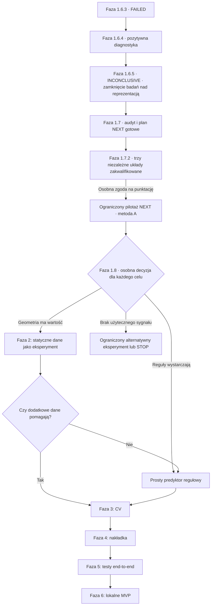
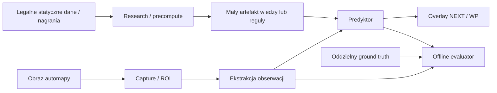

# D2R MapPredictor — Project Master Plan & Continuity Guide

**Wersja:** 1.2  
**Stan projektu:** 26 listopada 2026 r.  
**Aktualna faza:** 1.7.2 — niezależna kwalifikacja NEXT zakończona. Ograniczona punktacja metody A wymaga osobnej zgody właściciela.  
**Werdykt wykonalności na rzeczywistych danych D2R:** `INCONCLUSIVE` dla NEXT i WP  
**Środowisko właściciela:** Windows 10 x64, Visual Studio Code  
**Lokalny katalog projektu:** `D:/Projekty/D2MapPredicter/` (pisownia katalogu zgodna z raportami właściciela)  
**Charakter dokumentu:** nadrzędny zapis kontekstu, decyzji, roadmapy i zasad kontynuacji projektu.

> Ten dokument służy do wznowienia projektu bez dostępu do pierwotnej rozmowy. Stan bieżący i źródła pomiarów opisują raporty w repozytorium. [Status projektu](PROJECT_STATUS.md) · [Rejestr decyzji](DECISIONS.md)

## START HERE — checkpoint kontynuacji

| Obszar | Aktualny stan |
|---|---|
| Cel produktu | Lekki lokalny asystent NEXT/WP; użyteczna wskazówka do **nieodkrytego** celu |
| Badania reprezentacji 1.6–1.6.5 | ZAMKNIĘTE; nie powtarzać retestów ani holdoutów fingerprintingu |
| Ostatni niezależny test reprezentacji | 1.6.5 INCONCLUSIVE; 0/8 odzyskanych par po zmianie widoczności, 0/8 par spełniających próg C |
| Ground truth NEXT | Trzy zweryfikowane układy rozwojowe: mapa-01, mapa-02, mapa-07 |
| Niezależna ewaluacja NEXT | Kwalifikują się mapa-03, mapa-05 i mapa-10. Wykluczono mapa-08 z powodu warunków na zamrożonej klatce Stage 0. |
| WP | Brak zweryfikowanego punktu automapy i historii odkrycia; osobny tor badawczy |
| Realne predykcje D2R ocenione w benchmarku | 0 według dostępnych raportów; nie utożsamiać z 0% trafności |
| Testy | 46/46 testów i walidacja syntetyczna 10 układów oraz 39 klatek. Zamrożone artefakty historyczne zweryfikowano bez ponownej punktacji. |
| Najbliższe działanie | Decyzja właściciela o osobnej zgodzie na zamrożony pilotaż wyłącznie metody A. Istniejące nagrania i adnotacje wystarczają. |

To bieżący Master Plan i miejsce kolejnych aktualizacji. Najnowsze raporty i kod repozytorium, zamrożone protokoły i decyzje właściciela są nadrzędne wobec tego streszczenia. [Kwalifikacja 1.7.2](NEXT_EVALUATION_QUALIFICATION.md) · [Plan pilotażu](NEXT_PREDICTION_PILOT_PLAN.md)

## Spis treści

1. [Wizja i zakres produktu](#1-wizja-i-zakres-produktu)
2. [Mechanizm działania i ograniczenia](#2-mechanizm-działania-i-ograniczenia)
3. [Zasady techniczne i kryteria jakości](#3-zasady-techniczne-i-kryteria-jakości)
4. [Historia i aktualny stan projektu](#4-historia-i-aktualny-stan-projektu)
5. [Roadmapa całego projektu](#5-roadmapa-całego-projektu)
6. [Co zrobić teraz — faza 1.7](#6-co-zrobić-teraz--faza-17)
7. [Fazy 1.7–1.8 — benchmark i decyzja](#7-fazy-1718--benchmark-i-decyzja)
8. [Faza 2 — statyczne dane gry](#8-faza-2--statyczne-dane-gry)
9. [Faza 3 — Computer Vision](#9-faza-3--computer-vision)
10. [Faza 4 — minimalistyczna nakładka](#10-faza-4--minimalistyczna-nakładka)
11. [Fazy 5–6 — integracja i stabilizacja](#11-fazy-56--integracja-i-stabilizacja)
12. [Architektura docelowa i kontrakty](#12-architektura-docelowa-i-kontrakty)
13. [Ryzyka, alternatywy i warunki zatrzymania](#13-ryzyka-alternatywy-i-warunki-zatrzymania)
14. [Workflow agentów AI i utrzymanie kontekstu](#14-workflow-agentów-ai-i-utrzymanie-kontekstu)
15. [Prompt do wznowienia projektu](#15-prompt-do-wznowienia-projektu)
16. [Szablon aktualizacji statusu](#16-szablon-aktualizacji-statusu)

---

## 1. Wizja i zakres produktu

### Problem

W Diablo II: Resurrected gracz przemieszcza się po proceduralnie generowanych lokacjach. Szukanie przejścia do następnego poziomu i waypointu zajmuje czas, szczególnie przy wielokrotnym wykonywaniu tych samych tras.

### Produkt

D2R MapPredictor ma być **bardzo lekkim, lokalnym asystentem nawigacji**, który analizuje widoczną automapę i — w granicach faktycznie dostępnej informacji — pokazuje:

- **NEXT** — kierunek lub pozycję właściwego przejścia do kolejnej lokacji / poziomu.
- **WP** — kierunek lub pozycję waypointu.

W idealnym scenariuszu gracz wchodzi do lokacji, wykonuje teleport, a program już na podstawie dostępnych cech widocznej automapy sugeruje, gdzie szukać celu. Nie zakładać konieczności rozpoznania pomieszczeń, wejścia, całej mapy ani ciągłej historii ruchu; odporność na dowolną zmianę widoku pozostaje aspiracją wymagającą osobnej walidacji. Kolejne odkryte fragmenty mogą poprawić przewidywanie. Jeżeli cel został rzeczywiście odkryty, można oznaczyć jego potwierdzoną pozycję.

**Dokładne położenie nieodkrytego celu jest aspiracją, a nie obietnicą.** Użyteczna, uczciwie oznaczona wskazówka kierunkowa jest dopuszczalnym rezultatem pośrednim. Samo rozpoznawanie już widocznych ikon nie realizuje najważniejszego celu projektu.

### Non-goals — czego projekt nie robi

- Nie wykrywa potworów, przedmiotów, run, HP, many ani mikstur.
- Nie steruje postacią, nie klika, nie wykonuje teleportów ani innych akcji za gracza.
- Nie czyta pamięci procesu gry, nie wykonuje DLL injection, nie modyfikuje plików gry i nie przechwytuje ruchu sieciowego.
- Nie obchodzi mechanizmów anti-cheat.
- Nie wymaga konta, serwera, chmury, bazy danych ani modeli AI, o ile prostsze metody wystarczają.
- Nie jest pełnym maphackiem, botem, systemem SLAM ani uniwersalnym silnikiem rozumienia gier.
- Nie próbuje na początku obsługiwać wszystkich lokacji, poziomów trudności i wariantów interfejsu.

Rozwój i testy prowadzić na nagraniach oraz w trybie offline. Brak odczytu RAM nie jest gwarancją dopuszczalności narzędzia w Battle.net ani braku ryzyka sankcji. Nie deklarować zgodności z regulaminem bez osobnej, aktualnej weryfikacji.

## 2. Mechanizm działania i ograniczenia

### Główna hipoteza badawcza

Widoczna geometria automapy może zawierać informacje o strukturze proceduralnie generowanej lokacji. Jeśli rozpoznane pomieszczenia, ich orientacje i połączenia są związane z rozmieszczeniem przejść lub waypointów, można próbować oszacować kierunek do niewidocznych celów.

Hipoteza nie została jeszcze potwierdzona na realnych danych D2R.

### Aktualne podejście: predykcja bez konieczności identyfikacji mapy

Po zamknięciu badań reprezentacji pytanie brzmi: **czy informacja dostępna w chwili obserwacji pomaga przewidzieć kierunek ukrytego NEXT względem prostego baseline?** Nie jest wymagane odtworzenie całej mapy ani jednoznaczne rozpoznanie regionu. Jeżeli różne dopuszczalne hipotezy wskazują ten sam sektor, można rozważyć konsensus kierunkowy, o ile jego użyteczność zostanie wykazana na niezależnych układach.

| Metoda / ścieżka | Rezultat | Status |
|---|---|---|
| A — unconditional directional prior | Kierunek z częstości sektorów w zbiorze rozwojowym | Pierwszy baseline do pilotażu NEXT |
| B — entrance-conditioned prior | Kierunek warunkowany obserwowalną orientacją wejścia | Warunkowo; brak orientacji pozostaje UNKNOWN lub uruchamia wyłącznie udokumentowany fallback |
| C — geometry direction consensus | Kierunek wynikający z dopuszczalnych dopasowań referencji z etykietami NEXT | Warunkowo; istnieją matchery, brak dowodu wartości predykcyjnej |
| D — udokumentowana reguła generatora / statyczne dane | Kierunek lub ograniczenie przestrzeni możliwych celów | Osobny, ograniczony research, jeśli uzasadniony |
| Dokładna rekonstrukcja mapy / seeda | Potencjalna pozycja celu | Opcjonalna, nie jest warunkiem MVP; brak potwierdzonej wykonalności |

Nazwy A/B/C w pilotażu predykcji nie są tym samym co historyczne A/B/C matcherów (player-relative / strict / partial). W raportach zawsze podawać pełną nazwę metody. Nie wznawiać badań samych fingerprintów bez nowej, jawnie zatwierdzonej hipotezy dotyczącej wartości dla celu.

### Fundamentalne ograniczenie

Deterministyczne generowanie map nie oznacza, że można odwrócić generator na podstawie niewielkiego fragmentu jego wyniku. Dwa różne układy mogą mieć identyczną obserwowalną geometrię, ale różne położenia celów. Potwierdzono taki przypadek w syntetycznym kontrprzykładzie audytowym. Nie znamy częstości tego zjawiska w D2R.

Wyniki muszą rozróżniać:

- brak informacji (`UNKNOWN`, `INSUFFICIENT_DATA`),
- niejednoznaczność (`AMBIGUOUS`),
- predykcję kierunku (`PREDICTED`),
- predykcję położenia (tylko jeśli uzasadniona dowodami),
- rzeczywiście zaobserwowaną pozycję celu (potwierdzenie wizualne, nie predykcja).

Nie wyświetlać dokładnego punktu tylko dlatego, że jeden szablon pasuje najlepiej. Nie nazywać arbitralnego wyniku podobieństwa prawdopodobieństwem.

## 3. Zasady techniczne i kryteria jakości

### Priorytety projektowe

1. Poprawność i rzeczywista użyteczność predykcji.
2. Prostota: KISS, YAGNI, mała liczba zależności.
3. Niskie zużycie zasobów podczas rozgrywki.
4. Powtarzalność eksperymentów i rozliczalność decyzji.
5. Rozbudowa tylko na podstawie wyników, nie atrakcyjności technicznej pomysłu.

### Środowisko i stack

- Windows 10 x64, VS Code.
- C# / .NET jako preferowana technologia produkcyjna, nie bezwarunkowy wymóg.
- Python lub inna już używana technologia dopuszczalna w eksperymentach. Sprawdzić faktyczny stack w repozytorium; nie przepisywać działającego kodu tylko dla jednolitości języka.
- Faza 1 według raportu nie wymaga dodatkowych bibliotek.
- OpenCV / OpenCvSharp, Windows Graphics Capture lub Desktop Duplication, Direct2D lub prostszy mechanizm nakładki to kandydaci, a nie zatwierdzone zależności. Przed wyborem sprawdzić zgodność z konkretną wersją Windows 10 i zmierzyć koszty.

### Wstępne cele wydajnościowe runtime

| Metryka | Cel roboczy | Uwagi |
|---|---|---|
| CPU | poniżej 2% | Zdefiniować normalizację względem całego CPU, obciążenie i maszynę testową |
| RAM | poniżej 100 MB | Ustalić metrykę procesu, np. private working set, i raportować także peak |
| Aktualizacja predykcji | poniżej 100 ms | Mierzyć osobno koszt algorytmu i opóźnienie od zmiany obrazu do nakładki; p50/p95 |
| Analiza obrazu | adaptacyjnie; początkowo 10–15 Hz jako kandydat | Tylko gdy potrzebna, bez ciągłego kosztownego dopasowania |
| Sieć | brak zależności w trakcie pracy | Lokalna aplikacja |
| GPU | brak konieczności dedykowanego GPU dla AI | Sprzętowa akceleracja przechwytywania/renderowania jest dopuszczalna |

Cele nie są wynikami benchmarku ani ostatecznymi wymaganiami. Właściciel zatwierdzi progi przed testami akceptacyjnymi. Kosztowna prekomputacja może działać oddzielnie poza rozgrywką; jej czas i rozmiar wyników też trzeba mierzyć.

## 4. Historia i aktualny stan projektu

### Faza 0 — Research & Feasibility — zakończona

Opracowano koncepcję, wstępne podejścia algorytmiczne, plan badań oraz protokół eksperymentów. Rozważano template matching, graph matching, fingerprinting, reguły i seed reconstruction. Nie wykazano zgodności generatorów z D2R ani rzeczywistej trafności.

### Faza 0.5 — Independent Technical Audit — zakończona

Werdykt: `CONDITIONAL GO` (warunkowe GO).

Trzy główne założenia wymagające walidacji:

1. Geometria pierwszych trzech widocznych pomieszczeń poprawia przewidywanie względem prostej reguły orientacji wejścia.
2. Istotne cechy geometrii da się wiarygodnie odczytać z rzeczywistej automapy.
3. Skończona baza referencyjna reprezentuje mapy, które gracze faktycznie napotykają.

Audyt odtworzył przypadek syntetyczny, w którym idealnie pasujący lokalny wzorzec wskazywał błędny kierunek do obu celów. Zalecono realny pilotaż na Catacombs Level 2 zamiast natychmiastowej budowy generatora, CV i nakładki.

### Faza 1 — Experimental Implementation — zakończona implementacyjnie

Według raportu:

- Działają walidator, predyktor baseline, predyktor geometryczny i benchmark offline.
- Wszystkie **17 testów** przechodzi, w tym kontrprzykład niejednoznaczności.
- Po trzech pomieszczeniach metoda geometryczna podała kierunek w **1 z 3** kwalifikujących się przypadków dla każdego celu. W tym jednym przypadku obie metody były trafne.
- Są to dane syntetyczne. Nie dowodzą przewagi algorytmu ani trafności na rzeczywistych mapach D2R.
- Werdykt dla NEXT i WP: `INCONCLUSIVE`.

### Faza 1.5 — Data Acquisition — zakończona w dotychczasowym zakresie

Zebrano 10 nagrań, Catacombs Level 2, Normal, po wejściu z Level 1. Właściciel raportował D2R 3.4.95032, DWR ROW, Battle.net, obrazy 1920×1080. To kontekst źródłowy, nie niezależnie sprawdzona wersja klienta. Wszystkie nagrania zawierają zidentyfikowane późniejsze schody NEXT według raportu końcowego 1.6.5; nie oznacza to, że wszystkie mają zweryfikowany wczesny bearing. Liczba folderów nie stanowi dowodu liczby niezależnych układów. [Raport jakości](DATASET_QUALITY_REPORT.md) · [Wyniki końcowe reprezentacji](FINAL_REPRESENTATION_RESULTS.md)

### Faza 1.6 — Blind Annotation V1 — zakończona

Na `mapa-07` utworzono cztery izolowane pakiety Stage 0–3. Wszystkie cztery adnotacje przeszły intake, zostały zachowane bajt w bajt i zamrożone. Stage 3 zawierał sprzeczną deklarację ślepego pomieszczenia r01 bez potwierdzonego wyjścia; wyłączono ją tylko w kopii wykonawczej. Brak środka pomieszczenia wejściowego i orientacji we wszystkich czterech obserwacjach. Rejestracja: pierwotny maksymalny residual 1,58 px, dodatkowa kontrola do 1,86 px. NEXT: cztery kwalifikujące się checkpointy od strony celu, na jednym układzie, z celem nadal ukrytym; WP: brak zweryfikowanego punktu automapy i stanu odkrycia. Oba predyktory zwróciły UNKNOWN przy zerowym wsparciu niezależnych referencji. Oficjalny walidator odrzucił benchmark bez obu wymaganych splitów; 0 ocenionych predykcji dla każdego celu. 17 testów PASS. [Walidacja](PILOT_ANNOTATION_VALIDATION.md) · [Benchmark](PILOT_BENCHMARK_RESULTS.md) · [Wnioski](PILOT_FINDINGS.md)

### Faza 1.6.1 — Controlled Annotation Retest V2 — E · INCONCLUSIVE

Dwie klatki z mapa-07, po dwóch recenzentów, RAW i SEMANTIC: osiem wyników zachowanych i zweryfikowanych. Oba przebiegi przypisane jako SEMANTIC-first wykonano RAW-first po sprzecznej instrukcji zewnętrznej. Brak formalnie kwalifikujących się porównań kolejności. Opisowo: 40/40 par znaczników przeszło kryteria środka i zakresu w obu formatach; regiony Stage 3: 64% zgodności wobec 75% minimum; zero potwierdzonych połączeń i ślepych pomieszczeń. RAW walls Stage 3: 2/8 wobec 4 wymaganych; rozbieżności dotyczą segmentacji i wyboru próby. Orientacja wejścia UNKNOWN. Zachować rozróżnienie „niepotwierdzone” vs „nieistniejące”. 17 testów PASS. [Wyniki](ANNOTATION_RETEST_RESULTS.md) · [Decyzja](REPRESENTATION_DECISION.md)

### Faza 1.6.2 — Marker Fingerprint PoC — Recommendation B

Na zamrożonych obserwacjach V2 porównano player-relative markers, marker constellations i wariant z normalizowanymi ścianami (oparty na player-relative). Wszystkie zachowały 4/4 par pełnych widoków i 40/40 pojedynczych usunięć na przebieg. Konstelacje jako jedyne odzyskały trzy wspólne znaczniki przy przesunięciu gracza o ok. 448 px; nie wymagały orientacji wejścia. W RAW 2788 kwalifikujących się prób konstelacji: 58 niejednoznacznych zbiorów referencji, 40 niejednoznacznych przyporządkowań, 142 nierozstrzygnięte dopasowania 2D; 0 błędnych dopasowań w 1464 kontrolach zweryfikowanych jako odrębne. Ściany nie zmieniły żadnej decyzji kandydata i nie przeszły bramki wartości dodatkowej. p95 pojedynczej pary: 0,157 / 0,501 / 5,439 ms odpowiednio; koszt offline na przetworzonym JSON. 24 testy PASS. [Wyniki](MARKER_FINGERPRINT_POC_RESULTS.md)

### Faza 1.6.3 — Independent Layout Screen — kalibracja PASS, holdout FAILED

- Development: mapa-07. Calibration: mapa-06. Holdout: mapa-09. Po trzy widoki na nowy układ, dwa odrębne przebiegi RAW na widok, 12 ZIP-ów/12 zwrotów. Protokół marker-raw-v1, okno 448×352 na natywnym obrazie 1920×1080. Ściany nie są zbierane przez ślepego anotatora; pozostają niezależną podstawą rejestracji ewaluatora.
- Kalibracja: cap 4 px dla player-relative, 6 px dla strict constellations. Oba 6/6 same-frame; po ruchu odpowiednio 0/8 i 8/8. Konstelacje odzyskały 9/9 vs 9/11 znaczników po ruchu 82,93 px. Zero false unique, kolizji cross-layout i przerwań budżetu. p95 zapytania 0,186 / 0,870 ms. Zamrożony lock SHA-256 `97ce79e547ef756100fe93e0aee838f65500ac893fdae3b0d466181d73e8773a`.
- Holdout mapa-09: oba 6/6 same-frame, 0/8 po ruchu 133,67 px; 0/16 false unique, 0/24 cross-layout, brak przerwań budżetu. Trzy wspólne niekolinearne znaczniki z czterech po obu stronach, inny czwarty punkt w każdym widoku. Strict wymaga pełnego dopasowania mniejszego zbioru; dlatego odrzucił prawidłowy wspólny fragment. Bramka FAILED, nie zmieniać historycznego wyniku. 32 testy PASS. [Kalibracja](INDEPENDENT_LAYOUT_CALIBRATION_RESULTS.md) · [Holdout](INDEPENDENT_LAYOUT_HOLDOUT_RESULTS.md)

### Faza 1.6.4 — Bilateral Partial Constellation Matching — pozytywny screening (Recommendation A)

Nowy osobny matcher: stała translacja, cap 6 px na zgodność wektorów z uwzględnieniem promieni błędu, zgodność hue, maksymalne przyporządkowania jeden-do-jednego. Minimum 3 pary i 2/3 punktów każdego widoku (zaokrąglenie w górę); rozstrzygnięcie 2D wymaga dodatkowo ≥25% powierzchni bounding box obu chmur i wiarygodnego trójkąta (najdłuższy bok ≥24 px, najkrótsza wysokość > suma promieni). Zachowuje alternatywy, nie rozstrzyga na podstawie najniższego residualu.

- 16/16 kwalifikujących się maskowanych par odzyskanych wobec 8/16 dla strict. Wszystkie wcześniejsze pełne pary i kalibracyjne moved-view zachowane. Zero złych kandydatów w 148 realnych slotach negatywnych; zero false unique w 72 zapytaniach. Utrata ośmiu dopasowań przy skrajnej asymetrii 3/17. Obie metody odzyskały 34 pary ogółem. Próby maskowane są zależne i pochodzą z dwóch istniejących układów; nie świadczą o generalizacji.
- p95 pełnych zapytań 11,279 ms (strict 1,260 ms), syntetyczne 24 referencje 8,822 ms; enumeracja maksymalnych klik ma złożoność wykładniczą w najgorszym przypadku. Dwie korekty kontroli syntetycznych po pierwszym przebiegu zachowano wraz z pierwotnym wynikiem; matcher, protokół, progi i wyniki realne identyczne. 36 testów PASS. [Protokół](PARTIAL_CONSTELLATION_PROTOCOL.md) · [Wyniki](PARTIAL_CONSTELLATION_RESULTS.md)

### Faza 1.6.5 — Final Representation Holdout — INCONCLUSIVE, tor zamknięty

Nowy układ mapa-04, trzy widoki, sześć rzeczywistych zwrotów RAW. Zamrożona selekcja przed ponownym przeglądem materiału. Ruch gracza 100,42 px; potwierdzone obustronne zmiany widoczności (kursor zasłonił jeden glif, inny pojawił się dopiero później). Oba świadki potwierdzone w 8/8 skierowanych parach. Same-frame: 10/10, 19/19 i 6/6 zgodnych środków (łącznie 35/35, maks. 1,414 px). W każdej moved-view parze zweryfikowano 8 wspólnych punktów z 10 i 19 (80% i 42,11%); próg C wymagał 13, więcej niż liczebność mniejszego zbioru. Cztery pary nie spełniły też progu obszaru. Wszystkie 8 miały wiarygodny trójkąt, lecz 0/8 spełniło łączną bramkę. To nieudowodniona przewaga C, nie PASS ani dowód niemożliwości lokalnego dopasowania.

| Wynik zamrożonego testu | A: player-relative 4 px | B: strict 6 px | C: partial 6 px |
|---|---:|---:|---:|
| Same-frame | 6/6 | 6/6 | 6/6 |
| Moved-view (wszystkie operacyjne) | 0/8 | 0/8 | 0/8 |
| Zgodne błędne kandydatury | 0/44 | 0/44 | 0/44 |
| False unique | 0/16 | 0/16 | 0/16 |
| Przekroczenie budżetu | 0/16 | 0/16 | 0/16 |

16 zapytań i 58 slotów na metodę. Osiem skierowanych par reprezentuje jedno zdarzenie ruchu, nie osiem niezależnych map. Brak par spełniających zamrożony próg C w obu kierunkach oznacza INCONCLUSIVE; wskaźnik przewagi na tym podzbiorze jest niezdefiniowany. Lock SHA-256 `877fc9c32533691f623332acb48749811b8274c5b5aa04ebdcd56fe80fd5e8c6`; wynik `05cf64c5d5ef000028d8d4db5f88263cb15221ba3d40cde466c095a38ba069b4`. 41 testów PASS, syntetyczny walidator 10 układów/39 klatek, historyczny holdout mapa-09 sprawdzony bez powtórnej punktacji. Brak identyfikatorów sesji i czasów handoff; nie zgłoszono naruszenia niezależności, lecz metadanych nie należy wymyślać. [Przygotowanie](FINAL_REPRESENTATION_PREPARATION.md) · [Protokół](FINAL_REPRESENTATION_PROTOCOL.md) · [Wyniki](FINAL_REPRESENTATION_RESULTS.md)

Historyczne limity diagnostyczne dopasowania: 24 znaczniki na widok, 24 referencje na zapytanie, 100 000 prefiksów na parę, 256 zachowanych hipotez na parę, 600 000 prefiksów na zapytanie. Przerwane wyszukiwanie pozostaje unresolved, nigdy unique lub no-match. To limity badań, nie potwierdzony budżet produkcyjny.

**Decyzja strategiczna:** zamknąć reprezentację jako odrębny tor badań. Zachować kod, dane, pierwotne bajty, locki, protokoły, wyniki i testy. Nie zmieniać progów, nie uruchamiać kolejnego holdoutu reprezentacji. To, że możliwe jest lokalne dopasowanie, nie dowodzi identyfikacji mapy ani predykcji celu. Brak kolizji w małych zależnych próbach nie dowodzi unikatowości.

### Faza 1.7.1 — audyt NEXT i plan pilotażu

Audyt objął dziesięć nagrań i potwierdził trzy kierunki NEXT w zbiorze rozwojowym. Wskazał też cztery układy do niezależnej kwalifikacji ewaluacyjnej. [Audyt](NEXT_GROUND_TRUTH_AUDIT.md) · [Plan](NEXT_PREDICTION_PILOT_PLAN.md)

### Faza 1.7.2 — niezależna kwalifikacja NEXT — zakończona

Ewaluator zweryfikował blokadę wykonania przed dostępem do zastrzeżonych wyników. Zakwalifikował trzy z czterech układów do eksploracyjnej próby z zaślepionymi etykietami referencyjnymi. Historia wcześniejszego dostępu do nagrań pozostaje niepełna. W fazie 1.7.2 oceniono zero predykcji. NEXT i WP pozostają osobno **INCONCLUSIVE**. [Raport kwalifikacji](NEXT_EVALUATION_QUALIFICATION.md)

### Rejestr układów i ekspozycji

| Układ | Udokumentowane użycie | Rola NEXT po kwalifikacji 1.7.2 |
|---|---|---|
| mapa-01 | Audyt / selekcja nagrań | Development, zweryfikowany kierunek |
| mapa-02 | Audyt / selekcja nagrań | Development, zweryfikowany kierunek |
| mapa-03 | Wcześniejszy screening nagrań do 1.6.5 | Zakwalifikowany do ewaluacji eksploracyjnej |
| mapa-04 | Final holdout reprezentacji 1.6.5 | Poza proponowanym splitem NEXT; nie nazywać świeżym holdoutem |
| mapa-05 | Materiał z 10 nagrań | Zakwalifikowany do ewaluacji eksploracyjnej |
| mapa-06 | Kalibracja reprezentacji 1.6.3, diagnostyka 1.6.4 | Poza proponowanym splitem NEXT |
| mapa-07 | V1/V2, PoC, development reprezentacji | Development, zweryfikowany bearing |
| mapa-08 | Materiał z 10 nagrań | Wykluczony. Zamrożona klatka Stage 0 pochodzi z chwili po opuszczeniu miejsca wejścia, a znacznik gracza jest nieczytelny. |
| mapa-09 | Nieudany holdout reprezentacji 1.6.3 | Historyczny wynik; poza proponowanym splitem NEXT |
| mapa-10 | Materiał z 10 nagrań | Zakwalifikowany do ewaluacji eksploracyjnej |

„Poza proponowanym splitem” nie oznacza nieważnych nagrań. Każda zmiana ról wymaga udokumentowanego audytu dostępu, niezależności i uprzedniej zgody. Nie ujawniać wartości sektorów ani późniejszych klatek agentowi predykcyjnemu.

### Ważne istniejące pliki i odtworzenie wyników

Ścieżki względem `D:/Projekty/D2MapPredicter/`; istnienie i aktualność sprawdzić w repozytorium. Najnowszy plan i status mają pierwszeństwo przed historycznymi instrukcjami.

| Obszar | Pliki / katalogi |
|---|---|
| Kontynuacja | `docs/D2R_MapPredictor_PROJECT_MASTER_PLAN_v1.2.md`, `docs/PROJECT_STATUS.md`, `docs/DECISIONS.md`, `AGENTS.md`, `README.md` |
| Aktualny etap NEXT | `docs/NEXT_EVALUATION_QUALIFICATION.md`, `docs/NEXT_GROUND_TRUTH_AUDIT.md`, `docs/NEXT_PREDICTION_PILOT_PLAN.md`, `benchmarks/PROTOCOL.md` |
| V1 i V2 | `docs/PILOT_ANNOTATION_VALIDATION.md`, `docs/PILOT_BENCHMARK_RESULTS.md`, `docs/PILOT_FINDINGS.md`, `docs/ANNOTATION_RETEST_RESULTS.md`, `docs/REPRESENTATION_DECISION.md`, `docs/ANNOTATION_PROTOCOL_V2.md` |
| PoC i kalibracja | `docs/MARKER_FINGERPRINT_POC_RESULTS.md`, `docs/INDEPENDENT_LAYOUT_SCREEN_PLAN.md`, `docs/INDEPENDENT_LAYOUT_CALIBRATION_RESULTS.md`, `docs/INDEPENDENT_LAYOUT_HOLDOUT_RESULTS.md` |
| Partial i końcowy holdout | `docs/PARTIAL_CONSTELLATION_PROTOCOL.md`, `docs/PARTIAL_CONSTELLATION_RESULTS.md`, `docs/FINAL_REPRESENTATION_PREPARATION.md`, `docs/FINAL_REPRESENTATION_PROTOCOL.md`, `docs/FINAL_REPRESENTATION_RESULTS.md` |
| Dane i rejestracja | `docs/DATASET_QUALITY_REPORT.md`, `docs/REGISTRATION_VALIDATION.md`, `local-data/phase-1-6*`, `local-data/mapa-07/review/registration-check.json` |
| Kod | `research/geometry_experiment/`, `research/marker_fingerprint/`, `tests/`, `fixtures/synthetic/` |

Ostatnie udokumentowane komendy kontrolne (uruchamiać z root repozytorium, z wymaganymi prywatnymi danymi; bez ponownej punktacji holdoutów):

```powershell
python -B -c "import runpy; runpy.run_path('local-data/phase-1-7-2/verify_lock.py', run_name='__main__')" verify
python -B -m research.marker_fingerprint.run_final_holdout verify
python -B -m unittest discover -s tests -v
python -B -m research.geometry_experiment validate fixtures/synthetic
```

W fazie 1.7.2 przeszło 46 testów. Walidator syntetyczny przyjął 10 układów i 39 klatek. Zweryfikowano blokadę wykonania NEXT oraz zamrożone artefakty historyczne. [Weryfikacja](NEXT_EVALUATION_QUALIFICATION.md#verification)

## 5. Roadmapa całego projektu

| Faza | Nazwa | Status / bramka wyjścia |
|---|---|---|
| 0 | Research | ✅ Zakończona — plan badawczy |
| 0.5 | Independent Audit | ✅ Zakończona — warunkowe GO |
| 1 | Experimental Implementation | ✅ Implementacja i testy syntetyczne; walidacja D2R otwarta |
| 1.5 | Data Acquisition | ✅ Materiał na aktualny etap zebrany; przydatność do benchmarku do potwierdzenia |
| 1.6 | Blind Annotation | ✅ Pilotaż jednego układu i ponowna ocena adnotacji |
| 1.6.1 | Retest V2 | ✅ E · INCONCLUSIVE |
| 1.6.2 | Marker Fingerprint PoC | ✅ Etap zakończony. Historyczna rekomendacja B została wykonana w 1.6.3 |
| 1.6.3 | Test niezależnego układu | ✅ Ocena zakończona. Bramka reprezentacji niespełniona w porównaniach po zmianie pozycji gracza |
| 1.6.4 | Diagnostyka częściowego dopasowania | ✅ Pozytywny wynik diagnostyczny |
| 1.6.5 | Ostatni test reprezentacji | ✅ INCONCLUSIVE. Ścieżka badań nad reprezentacją zamknięta |
| 1.7.1 | NEXT Ground Truth Audit / Pilot Plan | ✅ Audyt i plan gotowe |
| 1.7.2 | Independent NEXT evaluation qualification | ✅ Blokada zweryfikowana. Trzy niezależne układy zakwalifikowane |
| 1.7.3 | Locked NEXT Directional Pilot | ⏳ Ograniczona punktacja metody A wymaga osobnej zgody właściciela |
| 1.8 | Feasibility Decision | ⏳ Wybór najprostszej uzasadnionej ścieżki |
| 2 | Static Game Data Integration | ⏳ Warunkowo — dowód kompatybilności i wartości statycznych danych |
| 3 | Computer Vision | ⏳ Automatyczna obserwacja widocznej geometrii |
| 4 | Lightweight Overlay | ⏳ Wskaźniki NEXT / WP na ekranie |
| 5 | End-to-End Validation | ⏳ Offline, jakość, wydajność i odporność na błędy |
| 6 | MVP Release & Maintenance | ⏳ Opcjonalnie — lokalne wydanie i kolejne wspierane lokacje |

Podział fazy 1.7 na 1.7.1–1.7.3 porządkuje istniejące zadania (numeracja redakcyjna, nie nowy protokół). Fazy 5 i 6 są doprecyzowaniem dalszego planu zaproponowanym w tym dokumencie. Fazy 2–6 nie są automatycznie zatwierdzone do wykonania. Po każdej istotnej bramce badawczej właściciel podejmuje decyzję. Możliwy jest krótszy wariant roadmapy (np. pominięcie fazy 2 przy wyborze reguł), ograniczony nowy eksperyment predykcyjny albo zakończenie projektu. Nie wznawiać reprezentacji jako osobnego celu.



## 6. Co zrobić teraz — faza 1.7

**Następna decyzja właściciela dotyczy ograniczonej punktacji metody A.** Trzy układy rozwojowe i trzy zakwalifikowane układy ewaluacyjne spełniają minimum eksploracyjne. Metoda B zachowuje `UNKNOWN` przy niepotwierdzonej orientacji wejścia. Metoda C nie ma wymaganej geometrii Stage 0 w zakwalifikowanych obserwacjach. Istniejący materiał wystarcza do próby A. [Gotowość i rekomendacja](NEXT_EVALUATION_QUALIFICATION.md#method-readiness)

Po osobnej zgodzie zweryfikować blokadę 1.7.2 i przeprowadzić próbę na zamrożonych obserwacjach Stage 0 w czterech ustalonych sektorach. Agent predykcyjny dostaje wyłącznie dopuszczone obserwacje i dane rozwojowe. Ewaluator łączy wyniki z kwalifikacją i etykietami po zamrożeniu odpowiedzi predyktora. Wynik tej próby opisze skuteczność bazową metody A na trzech układach. [Plan pilotażu](NEXT_PREDICTION_PILOT_PLAN.md) · [Kwalifikacja](NEXT_EVALUATION_QUALIFICATION.md)

### Zasady separacji ról (obowiązują nadal)

| Rola | Dostęp / zadanie |
|---|---|
| A — Blind Observer / Annotator | Wyłącznie wczesny dozwolony obraz i instrukcja; brak późniejszych klatek, celu i prywatnego manifestu |
| B — Ground Truth Annotator | Pełne nagranie, weryfikacja tożsamości celu, odkrycia, współrzędnych, rejestracji, niepewności |
| C — Independent Evaluator | Zamrożony protokół, wejścia i zastrzeżone etykiety; kwalifikacja i osobno zatwierdzona punktacja, bez strojenia |
| Implementer / Orchestrator | Dane development i dopuszczone dane wejściowe; nie ma dostępu do zastrzeżonych etykiet przed lockiem |

Fizyczna izolacja jest ważniejsza niż deklaracja. Nie udostępniać tego Master Planu ślepym anotatorom. Nie naprawiać obserwacji po ujawnieniu celu. Jeżeli sesja znała zastrzeżony wynik, odnotować ekspozycję i zastosować reguły kwalifikacji, a nie udawać zaślepienia.

### Historyczna procedura anotacji — tylko odniesienie

Pilotaż V1 (`b16-k9w4-00.zip` do 03) oraz retest V2 zostały wykonane i zamknięte. Ich kontrakty i wyniki pozostają w `BLIND_ANNOTATION_GUIDE.md`, `ANNOTATION_PROTOCOL_V2.md`, `PILOT_ANNOTATION_VALIDATION.md`, `ANNOTATION_RETEST_RESULTS.md`. Późniejsze paczki marker-raw-v1 (12 + 6) również zostały zwrócone i ocenione. Nie wykonywać archiwalnych checklist z wcześniejszych wersji Master Planu. Jeżeli zatwierdzony przyszły pilotaż NEXT wykaże potrzebę minimalnych dodatkowych obserwacji, odrębnie określić wymagane pola i liczbę klatek; zachować oryginalne zwroty, hashe, identyfikatory sesji, czasy i ograniczenia. Brakujące metadane oznaczać jako unknown. Instrukcja uniwersalna dla **historycznych** pakietów marker-raw-v1: `Open the single attached ZIP and follow its README.txt. Use only the files in that ZIP. Return the completed raw.json from that packet and include any limitations in its notes.` Nie jest poleceniem wysyłania nowych ZIP-ów teraz.

## 7. Fazy 1.7–1.8 — benchmark i decyzja

### 1.7 — Pilotaż kierunku do ukrytego NEXT (plan, nie wynik)

Pytanie dotyczy korzyści z informacji widocznej bezpośrednio po wejściu na Catacombs Level 2 z poziomu 1 na Normal. Punkt kontrolny to zamrożona klatka Stage 0. Wynik to jeden z czterech sektorów wektora od gracza do ukrytych schodów na poziom 3. Pozycja celu, rozpoznanie mapy i przejezdność trasy są osobnymi pytaniami. [Plan pilotażu](NEXT_PREDICTION_PILOT_PLAN.md)

- Minimum eksploracyjne obejmuje trzy zweryfikowane układy rozwojowe i trzy niezależne układy ewaluacyjne. Etykiety i późniejsze kadry zbioru ewaluacyjnego pozostają po stronie ewaluatora. Dobór metod, reguły kwalifikacji i kod muszą zostać zamrożone przed osobno zatwierdzonym otwarciem etykiet. [Podział i dostęp](NEXT_PREDICTION_PILOT_PLAN.md#split-and-evaluation-independence)
- Plan przewiduje prostą częstość sektorów, częstość warunkowaną orientacją wejścia i konsensus geometryczny. Po kwalifikacji 1.7.2 wykonalny jest ograniczony pilotaż metody A. [Metody](NEXT_PREDICTION_PILOT_PLAN.md#prospective-methods) · [Gotowość metod](NEXT_EVALUATION_QUALIFICATION.md#method-readiness)
- W przyszłym raporcie użyć jednej obserwacji na układ. Podać trafne, błędne i wstrzymane odpowiedzi, pokrycie, trafność wśród odpowiedzi, trafienia na kwalifikujący się układ i błąd kątowy. Porównanie przy tym samym pokryciu wymaga wyników co najmniej dwóch metod. Szerszy benchmark i ocena gotowości produktu zachowują własne kryteria. [Kryteria pilotażu](NEXT_PREDICTION_PILOT_PLAN.md#metrics-and-proposed-decision-criteria) · [Pełny benchmark](../benchmarks/PROTOCOL.md)

### Reguły interpretacji i ograniczenia przyszłego benchmarku

- Kierunek to bearing od aktualnego gracza do celu w natywnym układzie automapy, nie trasa przez korytarze. Dokładne osie, kąty, granice sektorów i reguły błędu w istniejącym protokole są nadrzędne; nie rekonstruować ich na podstawie przykładów z tego dokumentu.
- Używać jednej obserwacji Stage 0 na niezależny układ. Pilotaż wejścia nie dowodzi działania po teleporcie ani wejściu z WP/portalu. Minimalne 3+3 układy to screening, nie wystarczająca walidacja populacyjna.
- Dla konsensusu geometrycznego przenosić etykietę NEXT z każdej dopuszczalnej referencji do układu zapytania; zachowywać wszystkie dopuszczalne transformacje, grupować zduplikowane widoki po niezależnych referencyjnych układach, nie po wyniku podobieństwa. Przy braku wsparcia lub nierozstrzygniętym sektorze zwrócić UNKNOWN według zamrożonych reguł. Nawet zgodny kierunek kandydatów może być błędny poza korpusem.
- Oddzielać kwalifikację celu od dostępności metody; brak orientacji/cech lub wyczerpanie budżetu nie usuwa automatycznie trudnego układu z mianownika operacyjnego. Raportować coverage, trafność warunkową (niezdefiniowaną bez odpowiedzi), poprawne odpowiedzi na kwalifikujący się układ i porównania przy równym pokryciu.
- Dokładne kryteria decyzji i minimalne wsparcie odczytać z `NEXT_PREDICTION_PILOT_PLAN.md`. Nie dopisywać progów na podstawie wyników. Historyczne +10 pp jako robocza propozycja nie jest automatyczną bramką nowego pilotażu.

### 1.8 — Feasibility Decision

Werdykt wydawać **osobno dla NEXT i WP**. Projekt może wspierać tylko jeden cel na początku, ale wymaga to jawnej zgody właściciela na ograniczenie MVP.

| Werdykt | Znaczenie | Kolejne działanie |
|---|---|---|
| GO | Realne dane spełniają zatwierdzone kryteria użyteczności dla danego celu | Wybrać najprostszą uzasadnioną metodę; statyczne dane tylko przy wykazanej potrzebie |
| CONDITIONAL GO | Obiecujący sygnał, lecz zbyt mała próba lub konkretny brak | Zaplanować jeden eksperyment, który usuwa tę niewiadomą |
| PIVOT | Proste reguły dają porównywalną wartość | Wybrać reguły, uprościć produkt; faza 2 może być zbędna |
| NO-GO | Testowana metoda nie daje użytecznej predykcji | Zatrzymać tę metodę; nie budować na niej CV ani overlayu |
| INCONCLUSIVE | Brak rozstrzygających danych lub zbyt słaba ich jakość | Uzupełnić konkretne braki, nie rozbudowywać aplikacji w ciemno |

`NO-GO` dla testowanego predyktora geometrycznego nie dowodzi automatycznie, że każda metoda wykorzystująca statyczne dane jest niemożliwa. Alternatywną ścieżkę należy jednak uzasadnić nową, testowalną hipotezą. Decyzja o finansowaniu dalszego czasu pracy należy do właściciela.

**Bramka:** zapisać `PHASE_1_FINAL_VERDICT.md` lub aktualny odpowiednik; wskazać dokładnie, co udowodniono, czego nie, czy warto kontynuować i którą ścieżką. Nie uruchamiać fazy 2 automatycznie.

## 8. Faza 2 — statyczne dane gry

Faza warunkowa. Nie jest obowiązkowa, jeśli nawigacja regułowa osiąga oczekiwaną wartość. Nie importować dużych repozytoriów i nie generować milionów map przed ustaleniem sensu tych operacji.

### 2A — Compatibility Spike

**Cel:** ustalić, czy dostępne statyczne dane i generator opisują rzeczywiste mapy D2R w sposób wystarczający do naszego zadania.

Kandydaci do ponownego sprawdzenia (linki z wcześniejszego researchu, nie gwarancja aktualnego stanu lub kompatybilności):

- [emmericp/diablo2-maps](https://github.com/emmericp/diablo2-maps) — eksperymenty z mapami i seedem.
- [jaenster/libd2](https://github.com/jaenster/libd2) — potencjalne parsery i generowanie map.
- [jcageman/d2mapapi](https://github.com/jcageman/d2mapapi) — potencjalne generowanie map przy znanym seedzie.
- [OpenDiablo2/OpenDiablo2](https://github.com/OpenDiablo2/OpenDiablo2) — interpretacja danych gry.
- [lucas-gp/MapAssist](https://github.com/lucas-gp/MapAssist) — tylko odniesienie do statycznego generowania i reprezentacji map; nie używać mechanizmów pamięci procesu.

Dla wybranego komponentu zweryfikować kod, licencję, wymagane zasoby, obsługiwane wersje, działanie offline, sposób instalacji, możliwość ponownego użycia i wyniki na niezależnych danych D2R. Nie zakładać zgodności klasycznego D2 1.13c/1.14d z aktualnym D2R.

Pliki do sprawdzenia: DS1, DT1, Levels.txt, LvlPrest.txt, LvlMaze.txt, LvlTypes.txt, LvlWarp.txt, Automap.txt. Ustalić ich rzeczywistą dostępność i funkcję na podstawie kodu/parsera oraz danych; używać wyłącznie legalnie dostępnych lokalnych zasobów, nie modyfikować gry i nie dołączać zastrzeżonych plików gry do repozytorium ani wydania.

**Bramka 2A:** co najmniej jeden powtarzalny eksperyment porównujący statyczny szablon lub wynik generatora z rzeczywistą geometrią automapy, z jednoznaczną metodą dopasowania i opisem ograniczeń. Jeśli nie da się wiarygodnie wykazać zgodności generatora całych map, nie używać jego wyników jako ground truth D2R; można osobno badać zgodność pojedynczych szablonów.

### 2B — Minimal Tile/Room Library (wyłącznie jeśli potrzebna do predykcji)

- Dla jednej lokacji wybrać minimalny zbiór istotnych szablonów i reguł.
- Zdefiniować konwersję ze statycznej geometrii do reprezentacji automapy. Nie utożsamiać współrzędnych ekranu, świata, kolizji, pokoju i kafelka.
- Przygotować kompaktowe opisy połączeń, orientacji i istotnych cech. Nie przechowywać pełnych tekstur, jeśli wystarcza geometria.
- Sprawdzić kolizje sygnatur: różne pokoje lub konfiguracje mające ten sam opis.
- Potwierdzić na rzeczywistych klatkach, że wybrane cechy rzeczywiście da się rozpoznać.

### 2C — Matching & Prediction Experiment

Porównywać kolejno: baseline regułowy → dotychczasowy predyktor geometryczny → predyktor wzbogacony o statyczne dane. Dodawać jeden mechanizm naraz. Testować na osobnym zbiorze układów, których nie użyto do strojenia.

Jeśli zatwierdzona zostanie ścieżka statyczna, proponowana kolejność eksperymentów (nie kontynuacja zamkniętych retestów reprezentacji):

1. Rozpoznawanie małych szablonów i reguł orientacji.
2. Proste lokalne sygnatury (np. połączenia, graf sąsiedztwa, hash geometryczny).
3. Kompaktowe indeksy lokalnych wzorców i rozkłady możliwych położeń, jeśli poprzedni krok daje sygnał.
4. Dopasowanie większych konfiguracji dopiero po potwierdzeniu, że lokalne wzorce są niewystarczające.

Przed dużą prekomputacją zmierzyć liczbę unikalnych wzorców, duplikaty, rozmiar indeksu, czas wyszukania, niejednoznaczność i trafność na mapach spoza bazy. Nie mylić odnalezienia znanej mapy w indeksie z generalizacją na nieznany układ.

**Bramka 2C:** statyczne dane poprawiają trafność, pokrycie lub istotnie upraszczają runtime względem już zweryfikowanej metody. Jeśli nie — wrócić do lżejszego predyktora.

### 2D — Seed Reconstruction (opcjonalny, osobno zatwierdzany research)

Tylko jeśli właściciel nadal potrzebuje dokładnych pozycji nieodkrytych celów, a istnieją przesłanki, że obserwacje pozwalają ograniczyć przestrzeń kandydatów. Pracować na legalnych statycznych danych, mapach referencyjnych, własnych nagraniach i eksperymentach offline.

Najpierw oszacować, ile informacji wnoszą obserwacje, czy różne seedy dają te same cechy i czy rozbieżne konfiguracje mają różne cele. Zdefiniować budżet czasu, RAM i prekomputacji oraz jednoznaczne kryterium zatrzymania eksperymentu. Nie wdrażać nieograniczonego przeszukiwania przestrzeni ani nie uzależniać całego MVP od tej metody.

Rezultat może być negatywny: sam obraz nie musi pozwalać na jednoznaczne i szybkie odzyskanie seeda. Zachować możliwość rezygnacji lub predykcji kierunkowej bez rekonstrukcji.

## 9. Faza 3 — Computer Vision

**Warunek startu:** mamy wybraną użyteczną metodę predykcji, przetestowaną dotychczas z ręcznie opisanymi obserwacjami. Jeśli wybrano prosty baseline, ograniczyć CV do cech, których baseline potrzebuje. Nie budować uniwersalnego systemu analizy obrazu.

### 3A — Offline image processing

Na zapisanych klatkach, bez uruchamiania gry:

- Zdefiniować wspieraną konfigurację MVP: rozdzielczość, skalę UI, tryb automapy, grafikę klasyczną lub remastered. Wybrać jeden wariant na start.
- Zidentyfikować ROI automapy, odseparować jej geometrię od tła i efektów graficznych.
- Rozpoznać tylko potrzebne cechy: orientację wejścia, pozycję gracza, kontury/połączenia pomieszczeń, ewentualnie widoczne symbole NEXT/WP.
- Preferować proste maski kolorów, progi, kontury, linie i template matching zamiast AI. OCR nie jest wymagany, chyba że prostsze metody identyfikacji obszaru zawiodą i zostanie to uzasadnione.
- Odróżnić niewidoczne, nieodkryte, nieczytelne i potwierdzone elementy.
- Wyeksportować automatyczne obserwacje do tego samego lub kompatybilnego kontraktu, którego używa benchmark.

Zmierz zgodność automatycznych cech z niezależnymi adnotacjami, ale przede wszystkim ponownie zmierz końcową trafność predykcji. Dobra segmentacja sama w sobie nie jest dowodem dobrej nawigacji. Jeżeli automatyzacja obniża trafność zbyt mocno, poprawić wyłącznie problematyczne cechy lub uprościć model.

### 3B — Live screen capture

Po walidacji offline:

- Wybrać minimalny mechanizm przechwytywania dla Windows 10 i aktualnej konfiguracji maszyny.
- Przechwytywać wymagany obszar, nie cały pulpit, jeśli technicznie możliwe.
- Wykrywać zmianę istotnej geometrii i przeliczać predykcję tylko wtedy, gdy jest to potrzebne. Ruch tła lub animacji nie powinien sam powodować kosztownego dopasowania.
- Przechowywać najwyżej niezbędny bufor ostatnich klatek; unikać kolejek zaległych obserwacji.
- Rozpoznać brak automapy, utratę fokusu, zmianę rozdzielczości, ekran ładowania i zmianę lokacji. Jeśli automatyczne rozpoznanie lokacji okaże się kosztowne, dopuścić na początku ręczny wybór jedynej wspieranej lokacji.
- Nie wykorzystywać dostępu do procesu gry w celu pozyskania danych rozgrywki.
- Nie zapisywać zrzutów ekranu domyślnie. Tryb diagnostyczny wyłącznie na życzenie.

### 3C — Obsługa teleportacji i cyklu mapy

Dążyć do użytecznego wyniku z aktualnego obrazu również po dowolnym teleporcie, bez obowiązkowej historii od wejścia. Rozróżnić zmianę widoku w ramach tej samej mapy od rozpoczęcia nowego układu. W pierwszym przypadku wykorzystać wcześniejsze wiarygodne obserwacje tylko wtedy, gdy da się je poprawnie zarejestrować. W drugim wyczyścić stan. Gdy stan lub współrzędne są niepewne, zrezygnować z predykcji zamiast rysować stary kierunek.

**Bramka fazy 3:** automatyczne obserwacje dają użyteczne wyniki na niezależnych nagraniach, przechwytywanie działa w trybie offline i mieści się w uzgodnionym budżecie zasobów. Zweryfikować też wejście z WP/portalu i po teleportacji; nie deklarować ich obsługi na podstawie wyników tylko dla wejścia z L1.

## 10. Faza 4 — minimalistyczna nakładka

**Cel:** dostarczyć wartość bez zbędnego GUI. Nakładka nie może ukrywać obszaru walki ani przejmować sterowania.

### Zakres MVP

- Przezroczysta nakładka nad oknem gry, nieprzechwytująca kliknięć.
- Docelowo dwa czytelne znaczniki: `NEXT` i `WP`. W MVP wyłącznie cele osobno zweryfikowane i zatwierdzone przez właściciela; WP nie blokuje MVP NEXT, lecz nie może być reklamowany bez dowodów.
- Dla potwierdzonej pozycji — znacznik celu, jeśli mieści się w poprawnie zarejestrowanym widoku.
- Dla nieodkrytego celu — strzałka kierunkowa lub jawnie oznaczona przybliżona strefa, jeśli metoda jest zweryfikowana.
- Dla stanu `UNKNOWN` / `INSUFFICIENT_DATA` — brak strzałki; nie wymuszać odpowiedzi.
- W razie niejednoznaczności — najwyżej prosty sygnał niepewności, bez zalewania ekranu wieloma wariantami.
- Jeden skrót włączenia/wyłączenia nakładki i prosty sposób zamknięcia programu.
- Nakładka ukrywa się, gdy gra nie jest aktywna, automapa nie jest czytelna lub stan jest nieaktualny.

Nie dodawać PREV, dashboardu, śledzenia łupów, rozbudowanego menu ustawień ani planowania pełnej trasy, dopóki właściciel nie rozszerzy zakresu. Strzałka kierunkowa nie oznacza bezpiecznej, przejezdnej ścieżki; nie nazywać jej pathfindingiem.

### Wykonanie

Najpierw renderować znaczniki z zapisanych stanów predykcji, niezależnie od gry. Następnie podłączyć przepływ danych live. Wybrać prostą technologię renderowania zgodną z Windows 10. Zmierzyć wpływ DPI, zmiany rozmiaru okna, trybu borderless/windowed, przełączania okien oraz przejść między lokacjami. Nie obiecywać obsługi exclusive fullscreen, zanim nie zostanie przetestowana.

**Bramka fazy 4:** użytkownik widzi poprawnie rozróżnione wskazówki NEXT/WP w obsługiwanych scenariuszach offline, nakładka nie przeszkadza w rozgrywce, a jej koszt jest zmierzony. Nie wyświetla starych ani nieuzasadnionych predykcji.

## 11. Fazy 5–6 — integracja i stabilizacja

### Faza 5 — End-to-End Validation & Performance

Wykonać testy kompletnego przepływu: obraz → obserwacja → predykcja → nakładka. Oddzielnie mierzyć jakość samego predyktora, błędy CV, rejestrację i renderowanie, aby wiedzieć, gdzie powstaje problem.

Minimalne scenariusze:

- Pierwsze wejście do lokacji i kolejne odkrywanie pomieszczeń.
- Wejście przez WP lub portal, jeśli ma być wspierane.
- Krótkie i długie teleporty, utrata możliwości rejestracji, powrót do odkrytego miejsca.
- Wcześniejsze odkrycie NEXT niż WP i odwrotnie; cel poza kadrem.
- Zamknięta automapa, menu, ładowanie, Alt+Tab, utrata fokusu.
- Nowa mapa, zmiana lokacji, trudności, konfiguracji obrazu i DPI.
- Błędne, niepełne i niejednoznaczne obserwacje.
- Powtarzane sesje i dłuższy test pod kątem wycieków pamięci oraz narastania opóźnień.

Wskaźniki: końcowa trafność/pokrycie dla każdego celu, p50/p95 czasu reakcji, średnie i szczytowe CPU/RAM, wpływ na FPS gry i ewentualne zużycie GPU. Mierzyć na rzeczywistym komputerze właściciela; ustalić konfigurację, metodologię i punkt odniesienia (gra bez programu). Sprawdzić, czy zła wskazówka zwiększa czas szukania celu. Jeśli to możliwe, ocenić użyteczność w krótkiej próbie nawigacji z programem i bez niego na porównywalnych niezależnych mapach, offline.

**Bramka:** brak krytycznych błędów i wycieków danych, zaakceptowana jakość wskazówek, rzeczywiste pomiary zasobów, kontrolowane zachowanie w razie braku danych. W razie potrzeby zmniejszyć zakres, a nie ukrywać ograniczeń.

### Faza 6 — Local MVP Release & Maintenance

- Wydać prosty lokalny artefakt wykonywalny (format dystrybucji zależy od faktycznego stacku).
- Opisać uruchomienie, wspierane wersje Windows i gry, ustawienia automapy, wspierane lokacje oraz znane ograniczenia.
- Dołączyć tylko własne lub licencjonowane do redystrybucji komponenty. Nie pakować zasobów gry bez odpowiednich praw.
- Nie deklarować niewykrywalności, bezpieczeństwa konta ani dopuszczalności w rozgrywce online. Użytkowanie i walidacja projektu pozostają offline.
- Dodać wersjonowanie danych referencyjnych, krótki changelog oraz procedurę weryfikacji po aktualizacjach gry.
- Zabezpieczyć zachowanie przy niewspieranej wersji: ukryć lub ograniczyć wskazówki zamiast zwracać przypadkowe wyniki.
- Rozszerzać obsługę lokacji pojedynczo dopiero po zaakceptowaniu MVP. Forgotten Tower i Durance of Hate Level 2 pozostają kandydatami z pierwotnego planu, nie obietnicą obsługi.

MVP nie oznacza, że wszystkie pierwotne aspiracje zostały osiągnięte. Jasno opisać, czy produkt oferuje tylko kierunek, przewidywaną pozycję czy potwierdzoną pozycję odkrytego celu oraz dla których sytuacji.

## 12. Architektura docelowa i kontrakty

Architektura jest propozycją docelową, nie poleceniem tworzenia wszystkich modułów już teraz. Zachować aktualną strukturę repozytorium, jeśli działa.



### Research Engine (offline)

- Import i adnotacja danych.
- Walidacja i benchmarki.
- Eksperymenty z generatorami, regułami i szablonami.
- Prekomputacja, jeżeli jej wartość zostanie dowiedziona.
- Eksport minimalnego, wersjonowanego artefaktu potrzebnego runtime.

### Runtime Engine (finalny produkt)

- Przechwycenie ROI automapy.
- Ekstrakcja minimum obserwacji.
- Aktualizacja stanu mapy oraz wybrana metoda predykcji.
- Odczyt gotowych reguł / indeksu, jeśli wymagany.
- Nakładka NEXT/WP i minimalna obsługa cyklu życia.

Ground truth i pełne dane benchmarku nie są zależnością runtime ani wejściem predyktora. Nie przenosić całej infrastruktury badawczej do aplikacji użytkowej.

### Kontrakt obserwacji

Właściwy schemat istnieje w repozytorium. Poniższy przykład ilustruje pojęcia, a nie zastępuje go:

```json
{
  "area": "Catacombs2",
  "difficulty": "Normal",
  "entrance_orientation": "NE",
  "player_position": [0, 0],
  "visible_rooms": [],
  "visible_connections": []
}
```

Dokumentować układ współrzędnych, źródło cech, etapy obserwacji i niepewność. Identyfikatory map są metadanymi ewaluatora; nie mogą pozwolić predyktorowi rozpoznać odpowiedzi poprzez przypadkową korelację z etykietami.

### Kontrakt predykcji

Ilustracja możliwego stanu, do uzgodnienia z istniejącym kodem:

```json
{
  "target": "NEXT",
  "status": "PREDICTED",
  "direction": "NE",
  "confidence": null
}
```

Jeżeli runtime rozszerzy kontrakt, dodać jedynie potrzebne pola: rodzaj wyniku (kierunek/pozycja), potwierdzenie wizualne, układ współrzędnych, identyfikator bieżącego stanu mapy i informację o aktualności. Nie wprowadzać arbitralnej pewności procentowej. Wynik dla WP i NEXT jest niezależny. Wyświetlenie znacznika wymaga aktualnej obserwacji i poprawnej transformacji do ekranu.

### Orientacyjna struktura katalogów

```text
D2MapPredicter/
  README.md
  AGENTS.md
  docs/
    D2R_MapPredictor_PROJECT_MASTER_PLAN_v1.2.md
    ... istniejące raporty i protokoły ...
  research/                 # eksperymenty, jeśli potrzebne
  src/                      # faktyczny kod projektu
  tests/
  fixtures/                 # małe, kontrolowane dane testowe
  local-data/               # prywatne nagrania, paczki i adnotacje
  benchmarks/               # istniejące narzędzia / wyniki
```

Nie tworzyć pustych katalogów dla przyszłych faz. Sprawdzić `.gitignore`: lokalne nagrania, pełne mapy, prywatne dane, artefakty dużych obliczeń i oryginalne zasoby gry nie powinny przypadkowo trafić do publicznego repozytorium. Jeśli materiały są poza Gitem, przechowywać je w oddzielnej kopii zapasowej wraz z manifestem wersji.

## 13. Ryzyka, alternatywy i warunki zatrzymania

| ID | Ryzyko | Sposób sprawdzenia / ograniczenia |
|---|---|---|
| R1 | Widoczna geometria nie daje informacji o położeniu celu | Realny benchmark, przypadki identycznych obserwacji z różnym wynikiem, abstencja |
| R2 | Predyktor nie przewyższa prostego baseline | Porównanie przy takim samym pokryciu i na niezależnych mapach |
| R3 | Dane klasycznego D2 nie odpowiadają D2R | Compatibility spike na rzeczywistych danych; nie uznawać generatora za ground truth bez walidacji |
| R4 | Wzorce z indeksu nie generalizują | Ewaluacja poza bazą, test duplikatów, rozmiar i złożoność indeksu |
| R5 | Wyciek ground truth lub przyszłych obserwacji | Fizyczna izolacja danych, zamrożenie, osobne role, kontrola podziału per mapa |
| R6 | Błędna rejestracja klatek lub punktu WP/NEXT | Niezależne punkty kontrolne, statusy niepewności, analiza granic sektorów |
| R7 | CV nie odczytuje cech niezawodnie | Testy automatycznych cech na rzeczywistych kadrach i porównanie końcowej predykcji |
| R8 | Wydajność nie odpowiada idei lightweight | Pomiar p50/p95, CPU, RAM, FPS; uproszczenie, prekomputacja, aktualizacja przy zmianie |
| R9 | Teleport, zmiana obszaru lub nowa gra daje nieaktualną wskazówkę | Reset/inwalidacja stanu, testy cyklu życia, abstencja |
| R10 | Nadmierna rozbudowa przez agentów AI | Jeden mierzalny eksperyment na etap, kontrola zakresu i osobne approval gates |
| R11 | Aktualizacja gry lub systemu zmienia zachowanie | Wersjonowanie, lista wspieranych konfiguracji, testy po zmianach |
| R12 | Ograniczenia licencyjne lub regulaminowe | Weryfikacja źródeł/licencji, użycie offline, brak obietnic zgodności online |
| R13 | Zmienna widoczność i asymetria zbiorów znaczników | Historyczne wyniki 1.6.3/1.6.5; zachować abstencję i mierzyć wartość predykcji zamiast optymalizować samo dopasowanie |
| R14 | Mała i zależna próbka testowa | Liczyć niezależne układy, nie liczbę kombinacji par/masek; brak kolizji w próbie nie dowodzi globalnej unikatowości |
| R15 | Research hell: kolejne iteracje bez testu wartości produktu | Reprezentacja zamknięta; następna bramka dotyczy kwalifikacji NEXT i bezpośredniego pilotażu kierunkowego |

### Alternatywne ścieżki produktu

**A. Rule-based Navigator:** najprostszy wariant, jeśli reguły są dostatecznie przydatne; identyfikacja orientacji i obszaru, dwa kierunkowskazy. Bez pełnej bazy map.

**B. Geometry-assisted Navigator:** reguły wspierane rozpoznaną geometrią, niewielkim zbiorem wzorców lub rozkładami kierunków. Ścieżka warunkowa, tylko jeśli bezpośredni benchmark predykcji wykazuje przewagę nad prostszym rozwiązaniem.

**C. Static-data / seed-assisted Predictor:** ścieżka warunkowa, jeśli dodatkowe badania rzeczywiście uzasadnią dokładniejsze pozycje i koszt obliczeń. Nie traktować jako koniecznego elementu produktu.

**D. STOP / ograniczenie produktu:** jeśli nie można uzyskać użytecznych wskazówek do nieodkrytych celów, nie udawać, że samo zaznaczanie odkrytych ikon realizuje pierwotny cel. Taki prostszy produkt wymaga osobnej decyzji właściciela.

### Kiedy zatrzymać prace

- Brak realnych danych lub ground truth — blokada ewaluacji, nie pretekst do rozbudowy kodu.
- Brak przewagi nad baseline — pivot albo zakończenie testowanej metody.
- Brak wiarygodnej zgodności danych gry — zakończyć integrację niewiarygodnego źródła.
- Przekroczenie budżetu kosztownej prekomputacji lub brak realnej wartości — odrzucić dany wariant.
- Błędne wskazówki o nieakceptowalnej częstości — ograniczyć coverage, uprościć albo wstrzymać wydanie.

Nie istnieje obowiązek dojścia do ostatniej fazy. Projekt ma służyć właścicielowi, a nie realizacji roadmapy za wszelką cenę.

## 14. Workflow agentów AI i utrzymanie kontekstu

Wcześniej przyjęto model podobny do podziału Shaper / Orchestrator, rozszerzony o niezależnych audytorów i walidatorów.

| Rola | Odpowiedzialność |
|---|---|
| Owner / Shaper | Właściciel; cel, zakres, priorytety, zgoda na przejście faz, decyzja o kompromisach |
| Researcher | Weryfikuje hipotezy i źródła; tworzy mierzalny eksperyment |
| Orchestrator / Implementer | Wykonuje uzgodniony plan, małe zmiany, testy, reprodukcja |
| Independent Auditor | Szuka błędów w założeniach, metodologii, kodzie i dowodach; nie broni wcześniejszych decyzji |
| Blind Annotator (A) | W zatwierdzonych zadaniach anotacji widzi wyłącznie dozwoloną klatkę i formularz |
| Ground Truth Annotator (B) | Weryfikuje rzeczywiste położenie i widoczność celów |
| Validator / Evaluator (C) | Weryfikuje zamrożone dane i wyniki, bez strojenia pod zbiór testowy |

Nie wszystkie role wymagają osobnych osób przez cały projekt. Rozdzielenie sesji jest szczególnie istotne przy niezależnym audycie i ślepej adnotacji. Nie przekazywać tego dokumentu ślepemu anotatorowi.

### Stały cykl dla każdej kolejnej fazy

1. Odczytaj bieżący stan repozytorium, raporty i ostatnie decyzje.
2. Wybierz jedną niewiadomą / jedno zadanie, które odblokowuje następną fazę.
3. Zdefiniuj scope, non-goals i warunek zakończenia.
4. Wykonaj najmniejszy testowalny fragment pracy.
5. Uruchom testy, zapisz komendy i rzeczywiste rezultaty.
6. Niezależnie sprawdź krytyczne wnioski.
7. Zaktualizuj status, decyzje, ryzyka i następny krok.
8. Przed zmianą fazy, kosztowną operacją lub zmianą zakresu uzyskaj zgodę właściciela.

Nie tworzyć kolejnych wielkich dokumentów tylko dlatego, że zmienia się faza. Preferować aktualizację istniejących plików. W raportach rozdzielać fakty zweryfikowane, raportowane, założenia, hipotezy i blokady. Nie uznawać zielonych testów syntetycznych za realną trafność w D2R.

### Dokumentacja zachowująca kontekst

Zalecane minimum:

- `docs/D2R_MapPredictor_PROJECT_MASTER_PLAN_v1.2.md` — bieżący Master Plan, aktualizowany przy ważnych decyzjach.
- `docs/PROJECT_STATUS.md` — krótkie aktualne podsumowanie: co zrobione, ostatni test, blokada, jeden następny krok.
- Istniejący rejestr decyzji (np. `docs/DECISIONS.md`) — ważne rozstrzygnięcia i uzasadnienie.
- Istniejące raporty eksperymentów — dowody i komendy reprodukcji, nie zastępować ich streszczeniem.
- `AGENTS.md` — krótka instrukcja dla agentów: przeczytać master plan i status przed pracą oraz aktualizować status po zakończeniu zadania. Nie kopiować całej roadmapy do AGENTS.md.

Jeżeli repozytorium ma już równoważne pliki, użyć ich zamiast tworzyć duplikaty. W przypadku rozbieżności aktualny kod, zamrożone protokoły, wiarygodne wyniki i najnowsze decyzje właściciela są ważniejsze niż historyczny opis roadmapy.

**Ważne:** sam plik MD nie przechowuje kodu, nagrań, ground truth ani wyników benchmarków. Zachować repozytorium (np. Git + kopia), osobny backup `local-data/` i materiałów nieobjętych Gitem. W nowej sesji AI otworzyć repozytorium z tym dokumentem i aktualnym statusem. Jeśli nie ma dostępu do danych, nie pozwalać agentowi udawać, że je sprawdził.

## 15. Prompt do wznowienia projektu

Poniższy prompt jest dla nowej sesji agenta implementacyjnego/audytorskiego w VS Code, nie dla ślepego anotatora. Nie wymaga dostępu do poprzedniej rozmowy.

```text
# D2R MapPredictor — Project Continuation

Act as a pragmatic research engineer and software orchestrator.

This is an existing project, not a greenfield implementation.
Read and update docs/D2R_MapPredictor_PROJECT_MASTER_PLAN_v1.2.md as the current
master plan. Then inspect AGENTS.md, README.md,
the latest project status, actual source code, tests, experiment protocols,
audit findings and relevant reports. Locate equivalent files if names differ.
Treat repository evidence and the owner's latest decisions as authoritative.

Project objective: an extremely lightweight local navigation assistant for
Diablo II: Resurrected that predicts or indicates NEXT and WP using only
visible game imagery and legally accessible static data. No game process
memory reading, injection, game file modification, network interception,
anti-cheat bypass or gameplay automation. Development and validation are offline.

Preserve the validated scope, existing tools and experimental methodology.
Do not restart Phase 0, rewrite working modules or implement future phases
just because the master plan mentions them. Avoid overengineering.

First report:
1. Current phase and last completed verified task.
2. Actual test/benchmark status, citing repository evidence.
3. Open blockers and uncertainty, separately for NEXT and WP.
4. Any differences between the master plan and current repository state.
5. The smallest next actionable step, its acceptance criteria, and non-goals.
6. Which phase gate or hypothesis this step addresses.

Read docs/PROJECT_STATUS.md, docs/NEXT_GROUND_TRUTH_AUDIT.md,
docs/NEXT_EVALUATION_QUALIFICATION.md and docs/NEXT_PREDICTION_PILOT_PLAN.md.
The representation-only track is CLOSED. Phase 1.6.3 remains FAILED, Phase 1.6.4
passed diagnostic screening, and Phase 1.6.5 remains INCONCLUSIVE. Do not tune,
rescore, or repeat the frozen representation experiments. Do not collect new
annotation packets automatically. Preserve original data and all historical locks.

Phase 1.7.2 qualified mapa-03, mapa-05 and mapa-10 for target-blind exploratory
evaluation. mapa-08 failed at the fixed Stage 0 checkpoint. Development remains
mapa-01, mapa-02 and mapa-07. Verify the execution lock and preserve Stage 0 and
the four-sector convention. The next decision is whether the owner approves
locked Method A scoring. Method B retains UNKNOWN and Method C lacks usable
query geometry. Existing recordings and annotations suffice for the limited
baseline. Keep reserved outcomes, future footage and target registration
evaluator-side. Freeze prediction outputs before the evaluator joins truth.

NEXT and WP remain independently INCONCLUSIVE. WP anchor and discovery history
remain unresolved. The primary product question is hidden NEXT bearing utility,
not local fingerprint uniqueness. Do not require successful map identification.
The latest documented verification is 46 tests passing and synthetic
validation of 10 layouts / 39 frames; check actual current results. This does
not establish D2R predictive accuracy or production performance.

Proceed only within the current approved task. Before advancing to a new
phase or changing scope, present the evidence, decision and next step to
the project owner for approval.

When finishing any task, update the existing project status document:
- completed work and changed files;
- reproducible test/benchmark commands and actual results;
- remaining blockers and uncertainty;
- decisions and reasons;
- precise next step and acceptance criteria.

Be evidence-driven, concise, skeptical and pragmatic. The goal is a useful,
minimal product, not a large architecture or a positive research verdict.
```

### Krótka instrukcja do AGENTS.md

Instrukcja w `AGENTS.md` wskazuje ten plik jako bieżący Master Plan. Rozszerzony wzór instrukcji kontynuacji:

```markdown
## Project continuity

Before starting work, read `docs/D2R_MapPredictor_PROJECT_MASTER_PLAN_v1.2.md` and the latest
project status (prefer `docs/PROJECT_STATUS.md` if present). Verify the actual
repository state. Do not repeat completed phases or advance beyond the
currently approved scope. After each task, update the status with evidence,
changed files, test results, blockers, decisions and the exact next step.
Never disclose ground truth or this master plan to blind annotation sessions.
```

## 16. Szablon aktualizacji statusu

Po każdej zakończonej pracy aktualizować istniejący status na podstawie stanu repozytorium. Przykład opiera się na zakończonej fazie 1.7.2.

```markdown
# D2R MapPredictor — Current Status

Updated: 2026-11-26
Current phase: 1.7.2 — NEXT evaluation qualification complete
NEXT verdict: INCONCLUSIVE
WP verdict: INCONCLUSIVE

## Last completed work
- Representation-only track CLOSED; 1.6.3 FAILED, 1.6.4 diagnostic PASS,
  1.6.5 INCONCLUSIVE (0/8 moved pairs floor-eligible).
- Verification passed 46 tests and synthetic validation of 10 layouts and 39 frames.
- Three verified development layouts, three independently qualified evaluation layouts.
- The execution lock and frozen historical artifacts verified. Zero scored NEXT predictions.

## Current blocker
- Locked Method A scoring requires separate owner approval.
- Method B lacks confirmed entrance orientation. Method C lacks usable Stage 0 query geometry.
- WP still lacks verified automap anchor and early discovery history.

## Exact next step
- After owner approval, verify the lock and run the limited Method A pilot on
  the frozen Stage 0 observations. Freeze outputs before the evaluator joins truth.

## Evidence / changed files
- Link actual reports, data versions and hashes, code revisions, commands/results.
- Distinguish verified, reported, proposed and unknown information.

## Decisions since last update
- Representation-only experiments closed; preserve frozen artifacts.
- NEXT pilot takes priority; WP remains independent.

## Do not start yet
- More representation retests, matcher tuning or rescoring old holdouts.
- Prediction scoring before qualification, freeze and owner approval.
- Full static-data integration, CV, overlay, gameplay automation.

## Next gate
- Owner decision on locked Method A scoring.
```

---

## Najważniejsza zasada całego projektu

**Najpierw udowodnić, że potrafimy dostarczyć użyteczną informację o nieodkrytym celu. Dopiero później automatyzować pozyskiwanie tej informacji i wyświetlać ją w grze.**

Badania reprezentacji i kwalifikację NEXT zakończono. **Następna decyzja dotyczy osobnej zgody na ograniczony pilotaż metody A.** [Kwalifikacja NEXT](NEXT_EVALUATION_QUALIFICATION.md) · [Plan pilotażu](NEXT_PREDICTION_PILOT_PLAN.md)

### Historia wersji Master Planu

- v1.1 (plik wejściowy): aktualizacja do przygotowanego audytu i planu NEXT w fazie 1.7.
- v1.2 (26.11.2026): szczegółowa rekonstrukcja etapów 1.6–1.6.5 na podstawie raportów, rejestr układów, ujednolicenie stanu 1.7, usunięcie nieaktualnego polecenia ponownej adnotacji/holdoutu z aktywnych instrukcji, aktualny prompt kontynuacji i szablon statusu. Numeracja podetapów 1.7 jest redakcyjna. Nie modyfikowano kodu, danych, protokołów ani wyników eksperymentów. Nie weryfikowano lokalnego repozytorium ani nowszych raportów 1.7 niedostarczonych do tej redakcji.
- Aktualizacja v1.2 (26.11.2026) uwzględnia zakończoną kwalifikację 1.7.2 i wskazuje ten plik jako miejsce kolejnych aktualizacji Master Planu. [Wynik kwalifikacji](NEXT_EVALUATION_QUALIFICATION.md)
